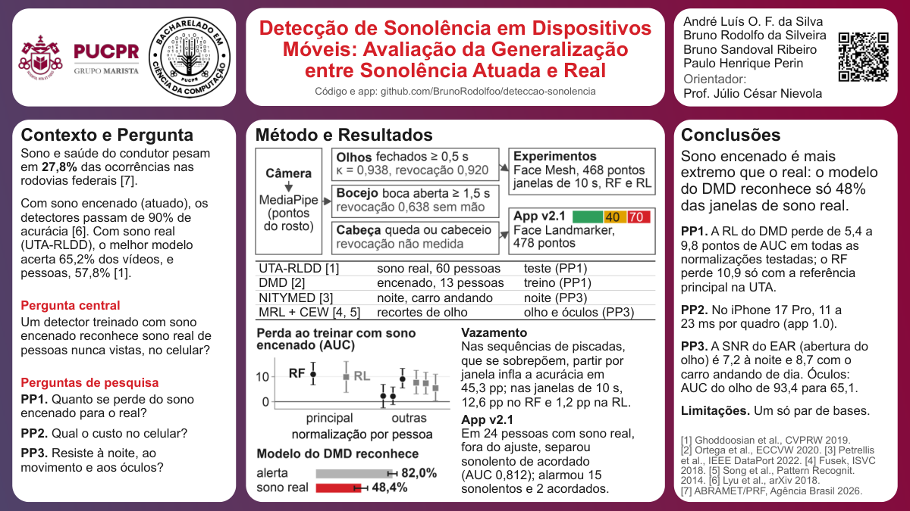

# Pôster (sessão de 16/11/2026)

Pôster final no template do professor (`material_disciplina/TemplatePoster.pptx`: 3 colunas, cabeçalho com os
logos, título em vermelho, nomes à direita). Versão de 27/10/2026: mensagem do PP1 igual à do artigo
reescrito (a perda depende do modelo e da normalização; o achado firme é que o modelo do DMD deixa passar boa
parte do sono real, em que os olhos fecham por menos tempo),
vazamento medido nas duas unidades (sequências de piscadas e janelas de 10 s), app v2.1 e iPhone 17 Pro.



## Arquivos

| Arquivo | O que é |
|---|---|
| `layout.py` | geometria fixa (cm): colunas, caixas brancas, figuras, tabela e cabeçalho; usada pelos dois scripts abaixo |
| `make_assets.py` | gera as figuras em `assets/` já no tamanho físico, com texto de 20 pt: `fig_poster_metodo.png` (diagrama: câmera e MediaPipe, sinais de olhos, bocejo e cabeça, experimentos com Face Mesh de 468 pontos e app v2.1 com Face Landmarker de 478 pontos), `fig_poster_exp5b.png` (PP1: perda de AUC ao treinar com sono encenado, no RF e na RL, na normalização principal e nas outras três, e quanto o modelo do DMD reconhece) e `qr_repositorio.png` (QR de `https://github.com/BrunoRodolfoo/deteccao-sonolencia`) |
| `build_poster.py` | gera `poster_final.pptx` (a partir do template, caminho em `POSTER_TEMPLATE`) e `poster_final.html` com o mesmo conteúdo e a mesma geometria; com `--pdf`, imprime o PDF, grava título e autores nos metadados, refaz a prévia e confere tudo |
| `numeros.json` | todos os números de resultado (gerado por `src/experiments/make_paper_numbers.py`; ver o fim deste arquivo) |
| `poster_final.pptx` / `.html` / `.pdf` / `_preview.png` | saídas; o PDF (1 página, 50,8 × 28,575 cm) é impresso do HTML pelo Chrome headless |
| `assets/` | figuras acima + `logo_pucpr.png`, `logo_bcc.png`, `fundo_gradiente.png` |

Gerar tudo (na raiz do repositório):

```bash
.venv/bin/python poster/make_assets.py && .venv/bin/python poster/build_poster.py --pdf
```

O `build_poster.py --pdf` chama o Chrome headless sem som (`--mute-audio`), espera o PDF ficar estável (até
120 s, porque o Chrome às vezes grava o arquivo e não termina) e depois confere fontes, traços, quebras de linha
e metadados. O `tools/atualizar_celular.sh` refaz números, figuras e pôster depois de um benchmark novo e
também chama `build_poster.py --pdf`, então o PDF sai com título e autores nos metadados.

## Regras ao alterar

- Edite **só** `build_poster.py` (texto), `make_assets.py` (figuras) e `layout.py` (posições). Não edite o
  `.pptx` à mão.
- **Números:** todo número de resultado vem de `numeros.json` pela função `N("NomeDoMacro")`, que dá erro se o
  macro não existir. Os únicos números digitados são da literatura, com a fonte no comentário: 27,8 %
  (ABRAMET/PRF, `paper/fontes_brasil.md`) e mais de 90 % no NTHU-DDD (Lyu et al., 2018,
  `paper/related_work_notes.md`).
- **Celular:** o PP2 mostra cada aparelho que existe em `numeros.json`, com a versão do app de cada medição
  (`CelularIPhoneVersaoApp`). O Galaxy S23 Ultra só aparece quando `samsung_medido = true`, com os macros
  `CelularSamsung...`; sem esses dados, o pôster não fala do Galaxy.
- **Fontes:** título 32 pt; títulos das colunas 28 pt; frase-síntese 24 pt; todo o resto, inclusive tabela,
  figuras e endereço do repositório, 20 pt; só as referências ficam em 16 pt. Os dois scripts param com erro se
  algum texto ficar menor.
- **Quebra de linha:** o `build_poster.py` quebra o texto com as medidas da Arial do sistema, deixa cada linha
  em no máximo 95 % da largura da caixa e grava as quebras no `.pptx` e no `.html`. As caixas são empilhadas
  pela altura medida, e o script para se algo não couber. Assim o PowerPoint, o Quick Look do macOS e o PDF
  mostram as mesmas linhas.
- **Template:** os cartões brancos do template eram grupos de forma livre que o Quick Look não desenha; o
  script os troca por retângulos arredondados na mesma posição e com o mesmo raio. A tabela é desenhada com
  caixas de texto e linhas finas, porque a tabela nativa do PowerPoint cresce no Quick Look. A fonte é Arial
  nas duas saídas (a Montserrat do template não está instalada).
- **Visual:** cinzas e o vermelho do título; verde e amarelo só no semáforo do app, dentro do diagrama. Nada de
  ícones, sombras ou caixas coloridas. Negrito só nos títulos, nos rótulos (PP1, PP2, PP3, Limitações) e em
  poucos números.
- **Texto:** frases curtas, sem travessão nem meia-risca, vírgula decimal.
- **Imagens:** nenhum rosto. Nada do DMD (CC BY-NC-ND e rostos), da UTA-RLDD (autorização de imagem restrita)
  nem do NITYMED; nenhum quadro do NTHU-DDD. As figuras são só gráficos e diagramas.
- **Conferência feita em 27/10/2026:** PDF com 1 página de 50,80 × 28,57 cm; menor fonte 20 pt em tudo e
  16 pt só nas referências, no PDF e no `.pptx`; as 81 linhas de texto do PDF iguais às do
  `.pptx`; nenhum travessão; metadados com título e autores nos dois arquivos; `.pptx` aberto no Quick Look
  (`qlmanage -t -s 2000`) e comparado com o PDF. **Imprima o PDF.**

## O que está no pôster (e de onde vem)

| Coluna | Conteúdo | Fonte |
|---|---|---|
| Cabeçalho | título, endereço do repositório, autores, orientador e QR | |
| 1. Contexto e Pergunta | ABRAMET/PRF 27,8 % (condições de saúde do condutor, sono incluído); encenado acima de 90 % e real 65,2 % (modelo dos autores da base), humanos 57,8 %; pergunta central; PP1 a PP3 | `paper/fontes_brasil.md`, `results/exp1_intra.md` |
| 2. Método e Resultados | diagrama do método com a validação dos sinais do app (olhos κ 0,938 e revocação 0,929 dos fechamentos de 0,5 s ou mais; bocejo 0,638 sem a mão; cabeça sem revocação medida) e o semáforo (40 e 70); tabela das bases; figura do PP1 com os rótulos no próprio gráfico (perda ao treinar com sono encenado, por normalização: RL de 5,4 a 9,8 em todas, RF 10,9 só com a referência principal na UTA; o modelo do DMD reconhece 82,0 % das janelas alertas e 48,4 % das de sono real); vazamento (45,3 pp nas sequências; 12,6 pp no RF e 1,2 pp na RL nas janelas de 10 s); app v2.1 em sono real (24 pessoas da UTA-RLDD, sentadas e fora do ajuste: AUC 0,812 entre sonolento e acordado; alarme em 15 sonolentos e 2 acordados) | `results/app_validacao*.md`, `results/exp5b_transferencia.md`, `results/exp2_leakage.md` |
| 3. Conclusões | frase-síntese (treinado com sono encenado, o modelo só reconhece 48,4 % das janelas de sono real, com fechamentos mais curtos); PP1; PP2 (iPhone 17 Pro, 11 a 23 ms por quadro, app 1.0); PP3 (SNR do EAR 7,2 à noite, 8,7 com o carro andando e 13,6 parado, de dia; óculos, AUC do olho de 93,4 para 65,1); limitações (um só par de bases); referências | `results/exp4_phone_latency.md`, `results/exp6_noite.md`, `results/exp3_eye_state.md` |

## Roteiro da apresentação (10 min, 4 falas de 2,5 min)

Divisão da equipe (contexto de 15/09): André, dados e Pipeline A; Bruno Sandoval, Pipeline B (olho);
Bruno Rodolfo, celular e repositório; Paulo, escrita e pôster. Cada um fala da parte que fez, com as próprias
palavras; o texto abaixo é só um guia. Aponte para o pôster enquanto fala. Os números são os do pôster: se
ele mudar (por exemplo, com a medição nova do celular), use os números novos.

### Fala 1, Paulo: problema e pergunta (coluna 1), de 0:00 a 2:30

- **Abertura (20 s):** "Segundo a ABRAMET, com dados da PRF, 27,8 % das ocorrências registradas nas rodovias
  federais entre 2014 e 2024 tiveram a ver com a saúde do condutor, e o sono entra aí. A ideia é ter um celular no
  painel que avise o motorista."
- **O problema (1 min):** "Os trabalhos que usam sono encenado, em que a pessoa finge que está com sono,
  passam de 90 % de acurácia. Na UTA-RLDD, que tem sono de verdade, o modelo dos autores da base acerta 65,2 % dos
  vídeos, e pessoas olhando os mesmos vídeos acertam 57,8 %. A gente quis entender de onde vem essa
  diferença."
- **Um cuidado (30 s, sem texto no pôster; os números estão no quadro "Vazamento" da coluna 2):** "Muitos
  trabalhos dividem treino e teste por janela. Aí pedaços do mesmo vídeo caem nos dois lados, e o modelo é
  testado em algo que já viu. Aqui a pessoa do teste nunca aparece no treino."
- **Pergunta e PPs (40 s):** ler a pergunta central e as três perguntas. Passar para o André: "o André vai
  mostrar como a gente mediu isso."

### Fala 2, André: método, PP1 e vazamento (coluna 2), de 2:30 a 5:00

- **Método (40 s, diagrama):** "O vídeo passa pelo MediaPipe, que marca pontos do rosto. Nos experimentos
  usamos o Face Mesh, com 468 pontos; no app, o Face Landmarker, com 478. Daí saem os sinais de olhos, bocejo e
  cabeça. Nos experimentos, cortamos os vídeos em janelas de 10 s e treinamos Random Forest e regressão
  logística, sempre testando em pessoas que o modelo nunca viu."
- **Bases (20 s, tabela):** UTA-RLDD tem sono real (60 pessoas); DMD, sono encenado (13 pessoas); NITYMED é a
  noite; MRL e CEW são recortes de olho.
- **PP1 (1 min 10 s, figura):** "O gráfico de cima compara o modelo treinado na UTA com o treinado no DMD,
  os dois testados na UTA: é o quanto se perde treinando com sono encenado. Na regressão logística, a perda fica
  entre 5,4 e 9,8 pontos de AUC em todas as formas de normalizar os dados de cada pessoa. No Random Forest, os
  10,9 pontos só aparecem com a referência principal na UTA: com outra referência na UTA ou sem centragem, a
  diferença fica em uns 2 pontos e não dá para separar de zero. Isso acontece porque, na UTA, as janelas alertas
  saem do mesmo vídeo usado como referência, e o Random Forest treinado lá aproveita isso. O resultado mais firme
  está embaixo: o modelo do DMD reconhece 82,0 % das janelas alertas, mas só 48,4 % das de sono real. Nas janelas
  sonolentas, o maior fechamento de olho tem mediana de 0,97 s no DMD e de 0,17 s na UTA. Os erros combinam com um
  sono encenado mais intenso, em parte pela regra de rótulo do DMD."
- **Vazamento (30 s, texto à direita da figura):** "Também medimos o vazamento. Nas sequências de 30 piscadas,
  que se sobrepõem, dividir por janela leva a acurácia de 54,2 % para 99,5 %, 45,3 pontos a mais. O que infla
  é ter pedaços do mesmo vídeo nos dois lados: dividindo por vídeo, o resultado fica até abaixo da divisão por
  pessoa, 47,2 %. Nas janelas de 10 s, o efeito depende do modelo: 12,6 pontos no Random Forest e 1,2 na
  regressão logística. Isso não explica os 90 % da literatura, que foram medidos com outras pessoas no teste."
  Passar para o Bruno Sandoval.

### Fala 3, Bruno Sandoval: noite, movimento e óculos (PP3), de 5:00 a 7:30

- **Noite e movimento (1 min 10 s, coluna 3, PP3):** "À noite, no NITYMED, o rosto continua sendo encontrado
  em 99,15 % dos quadros. O que piora é o sinal do olho. O EAR é a medida de abertura do olho, e a SNR diz
  quanto a piscada se destaca do ruído: ela cai para 7,2, contra 21,5 na UTA. Só que, com os mesmos motoristas
  do DMD, de dia, o carro andando já leva a SNR a 8,7. A diferença entre a noite e o carro andando não dá para
  separar de zero. Então boa parte do que parece efeito da noite vem do movimento."
- **Óculos (40 s):** "Para o olho, treinamos uma CNN pequena. Treinada no CEW e testada no MRL, a AUC cai de
  93,4 sem óculos para 65,1 com óculos. No DMD, o detector de piscadas falhou num dos três motoristas de
  óculos. Óculos são o caso difícil."
- **Por que regras no app (30 s):** "Por isso o app usa regras simples sobre olhos, bocejo e cabeça, calibradas
  em cada pessoa. Não é que a regra acerte mais: com o mesmo falso alarme, a regressão logística do DMD acha
  tanto sono quanto ela. A vantagem é não precisar de treino e cada alarme ter uma explicação." Passar para o
  Bruno Rodolfo.

### Fala 4, Bruno Rodolfo: o app no celular (PP2), conclusões e limitações, de 7:30 a 10:00

- **App v2.1 (50 s, diagrama e celular na mão):** "O app soma olhos, bocejo e cabeça num nível de 0 a 100:
  amarelo a partir de 40, vermelho a partir de 70, com alarme. Olho fechado por 1 s ou mais vai direto para o
  vermelho. O botão 'Por quê?' mostra de onde veio cada ponto. Tudo roda no aparelho, sem mandar vídeo para
  fora."
- **Demonstração (40 s, se não houver fila):** piscar normal fica verde; fechar os olhos por 2 s vai ao vermelho
  com sirene; abrir os olhos volta ao amarelo. Antes, subir o volume para 100 % (o padrão é 20 %).
- **PP2 (30 s):** "No iPhone 17 Pro, a versão 1.0 do app levou de 11 a 23 ms por quadro, em duas execuções. A
  versão 2.1 está sendo medida no iPhone e no Galaxy S23 Ultra." Se o pôster já trouxer a medição nova, ler os
  números dele.
- **Validação e limitações (30 s):** "Testamos o app em 24 pessoas da UTA-RLDD com sono real, sentadas e fora do
  ajuste das regras: ele separou sonolento de acordado com AUC 0,812, no nível do Random Forest treinado no DMD
  (0,811), e deu alarme em 15 de 24 sonolentos e em 2 de 24 acordados. Na direção real do DMD, ficou 3,3 % do tempo em vermelho, mas são os mesmos vídeos do ajuste. As limitações: é um
  só par de bases, o DMD tem só 13 pessoas, e à noite não temos vídeos de gente alerta."
- **Fechamento:** "Resumindo: treinar com sono encenado não basta para reconhecer sono real. Os erros combinam com
  um sono encenado mais intenso, em parte pela regra de rótulo do DMD. E o teste tem que ser sempre em pessoas
  novas." Mostrar o QR.

## Perguntas prováveis (respostas curtas, com os números do pôster e do artigo)

1. **Por que não usaram o NTHU-DDD, a base atuada mais citada?** O acesso exige um termo assinado pela chefia
   institucional e não tinha prazo de resposta. O DMD cumpre o mesmo papel (sono encenado, rótulo por quadro) e
   tem licença para pesquisa. A troca está registrada como alteração do planejamento.
2. **A queda do PP1 não pode ser só câmera e ambiente?** Pode ter parte disso: com um só par de bases, a troca
   muda câmera, cenário e tipo de rótulo ao mesmo tempo. O volume do treino explica pouco: com o modelo da UTA
   treinado com só 13 pessoas, como o DMD, a perda continua (9,3 pontos no RF e 7,0 na RL). O que aparece em todos os controles
   é o modelo do DMD deixar passar a maior parte das janelas sonolentas reais.
3. **Por que o RF perde 10,9 e depois quase nada?** Na UTA-RLDD, as janelas alertas saem do mesmo vídeo usado
   como referência na normalização, e o RF treinado lá aproveita isso. Com a referência no vídeo de pouca vigilância ou sem
   centragem, a AUC do RF treinado na UTA cai de 80,1 para 68,4 e 69,4, e a perda vira 2,3 [−2,5; 6,8] e
   2,1 [−1,2; 5,8], que incluem zero. Na RL, a queda por janela fica entre 5,4 e 9,8, sempre com IC acima de zero.
4. **O resultado não depende do limiar 0,5?** A AUC não depende de limiar. Com o limiar calibrado só no DMD
   (0,662), o modelo reconhece ainda menos janelas sonolentas: 37,0 %.
5. **Trocar o extrator oficial (dlib) pelo MediaPipe não piorou tudo?** Não: com o mesmo modelo, a diferença
   oficial menos nosso é 2,0 [−4,8; 8,5] pp e inclui zero (Exp. 5a). Com cada extrator treinado e testado no
   seu próprio sinal, o nosso é melhor no esquema B3: −6,7 [−12,9; −1,8] pp, p = 0,029, mas essa vantagem some
   deixando um sujeito de fora: −4,5 [−11,0; 0,6].
6. **Como vocês sabem que os 45,3 pp são vazamento?** Mesmos dados, mesmo modelo; só muda a divisão. Por
   janela, 97,1 % dos vídeos de teste também aparecem no treino e a acurácia vai a 99,5 %; por pessoa, 54,2 %;
   por vídeo, 47,2 %. Sequências vizinhas dividem 28 de 30 piscadas, então o teste vê quase o mesmo que o
   treino.
7. **O NITYMED tem sono real?** A página oficial não diz se bocejos e microssonos foram espontâneos; três
   bocejos por vídeo sugerem instrução. Por isso ele só entra no PP3 (captura e qualidade do sinal à noite),
   nunca no PP1. Baixamos 126 vídeos; a página declara 130.
8. **Então a noite não atrapalha?** Atrapalha o sinal (SNR 7,2 contra 21,5 na UTA), mas o carro andando de dia
   já dá quase a mesma perda (8,7), com os mesmos motoristas. Sem vídeos noturnos de pessoas alertas, não dá
   para medir falso alarme à noite: está nas limitações.
9. **Por que o app não usa o modelo para decidir?** No limiar 0,5, os modelos marcam sono em 26,0 % a 43,6 %
   das janelas de pessoas acordadas da UTA-RLDD, e a regra em 2,6 %, mas esse limiar é arbitrário. Escolhendo
   o limiar que dá o mesmo falso alarme da regra, a RL do DMD com centragem acha 24,7 % das janelas sonolentas,
   e a regra, 24,1 %; os modelos sem centragem acham menos (15,3 % e 19,2 %). A regra não acerta mais; ela não
   precisa de treino e cada alarme tem explicação. O LSTM entra só como reforço limitado.
10. **Qual o falso alarme do app?** No teste independente em sono real (24 pessoas da UTA-RLDD, sentadas e fora
    do ajuste), 2 de 24 vídeos de pessoas acordadas deram alarme. Na direção real do DMD (63,3 min), 3,3 % do tempo
    em vermelho, e 16 das 17 sessões sem nenhum alarme. São os mesmos vídeos usados para ajustar as regras, então é um número de
    desenvolvimento. O caso ruim conhecido é um motorista (gA_5) que olha muito para baixo: o olhar baixo é
    lido como olho fechado (55,8 % do tempo em vermelho).
11. **E a revocação? O app pega quem está com sono?** No teste independente em sono real (24 pessoas da
    UTA-RLDD, sentadas e fora do ajuste), 15 de 24 vídeos sonolentos chegaram ao vermelho, e a AUC entre sonolento
    e acordado foi 0,812, no nível do Random Forest treinado no DMD (0,811). Por sinal, no DMD: olho fechado por
    quadro, κ = 0,938 offline (0,902 no navegador); fechamentos de 0,5 s ou mais, revocação 0,929 (0,920 nos de
    1 s ou mais); bocejo, 0,638 sem a mão na boca e quase nulo com a mão (0,026); cabeça caindo, sem revocação
    medida, porque o DMD não anota isso.
12. **Os pesos do nível (40, 70, pontos por sinal) foram ajustados nos dados?** São escolhas de projeto,
    documentadas em `app/pwa/README.md`, e não foram ajustados em sono real. Mas a regra dos olhos e os ajustes
    da v2.1 foram escolhidos olhando os mesmos vídeos do DMD da validação; por isso os números do app no DMD são
    de desenvolvimento. O teste independente é o da UTA-RLDD: 24 pessoas sentadas e fora do ajuste, AUC 0,812
    (o RF do DMD dá 0,811), 15 de 24 sonolentos no vermelho e 2 de 24 acordados com alarme.
13. **O iPhone mostra o custo do app final?** Ainda não: as duas execuções no iPhone 17 Pro usaram a versão
    1.0, e a 2.1 está sendo medida. O custo maior é o MediaPipe (9 a 19 ms dos 11 a 23 ms por quadro), que a
    v2.1 também usa. Numa das execuções, a v1 deu falso alarme com o André acordado (PERCLOS 25,8 %, alarme em
    63,4 % dos quadros), e foi isso que levou à reescrita.
14. **Por que o iPhone e não o Galaxy S23 Ultra do planejamento?** O S23 Ultra é de um colega e está sendo
    medido na PUC. Quando o benchmark entrar, `bash tools/atualizar_celular.sh` e depois
    `.venv/bin/python poster/build_poster.py --pdf` atualizam artigo e pôster; o Galaxy aparece sozinho no PP2.
15. **E os óculos escuros?** Não medimos óculos escuros. Com óculos comuns, a CNN do olho treinada no CEW e
    testada no MRL cai de AUC 93,4 para 65,1; no DMD, o detector de piscadas falhou num dos três motoristas de
    óculos.
16. **Dá para reproduzir?** Sim: código, figuras e o app estão no repositório do QR; os números do pôster e do
    artigo saem de `results/` por um script e são conferidos automaticamente.

## Números gerados

`poster/numeros.json` (chave `valores`: nome do macro → texto pt-BR, por exemplo
`"ExpCincoBLRQuedaNormMin": "5,4"`) é gerado por `src/experiments/make_paper_numbers.py` com os MESMOS valores
de `paper/numeros.tex`; a origem de cada um está em `results/numeros_resumo.md`. Depois de um benchmark novo no
celular, `bash tools/atualizar_celular.sh` refaz importação, figura do Exp. 4, números e artigo; em seguida,
`.venv/bin/python poster/build_poster.py --pdf` refaz o pôster com os metadados completos.
