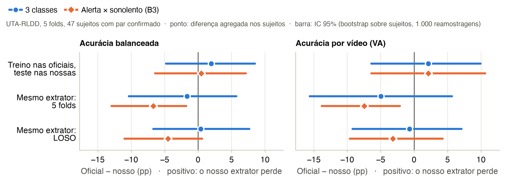
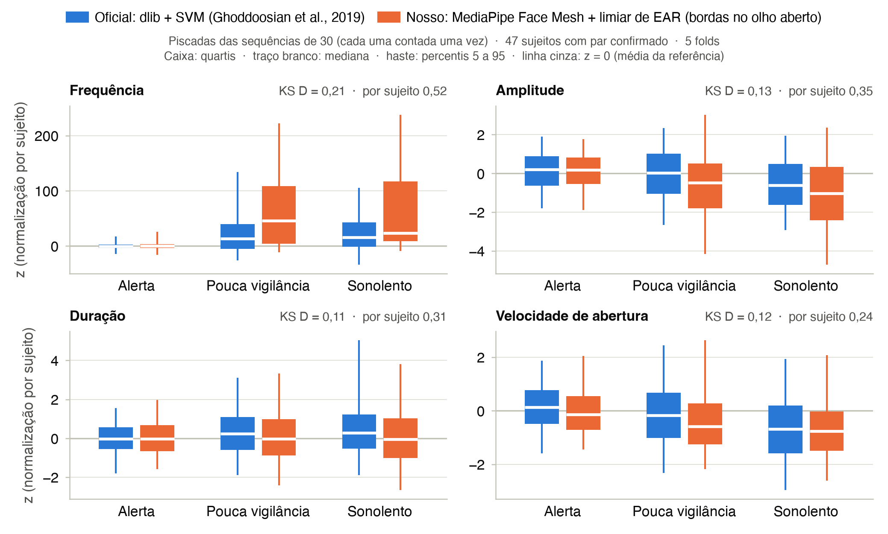

# Exp. 5a — Validação do nosso extrator contra as características oficiais da UTA-RLDD (rodada final, 5 folds)

Gerado por `src/experiments/exp5a_validacao.py` em 27/09/2026 22:17 (log: `results/logs/exp5a_validacao_20260927-221239.log`). Nenhum número deste arquivo foi digitado à mão: tudo vem dos CSVs da seção 9. Reproduzir, depois de `bash src/features/run_features.sh`: `bash src/experiments/run_exp5a.sh` (detector de rosto do dlib no `.venv-mp`, `src/experiments/exp5a_dlib_rosto.py`, incremental; verificação independente do mapeamento, `src/experiments/exp5a_mapeamento_indep.py`; e este script, no `.venv`). A rodada preliminar (só o Fold 1) foi descartada; seus arquivos foram removidos em 06/10/2026.

**Pergunta.** Um modelo treinado nas características oficiais da UTA-RLDD (dlib + SVM de olho fechado, Ghoddoosian et al., 2019) mantém o desempenho quando recebe as NOSSAS características dos mesmos vídeos (MediaPipe Face Mesh + detector de piscadas por limiar, `src/features/`)? A diferença isola o custo de trocar o extrator, sem trocar de base. O Exp. 5b troca a base (DMD atuado → UTA real), mas usa o nosso extrator nas duas pontas.

**Sujeitos.** Os `.npy` oficiais têm 58 sujeitos em 5 folds (os folds 1 e 5 têm 11); o artigo descreve 60. O mapeamento sujeito oficial ↔ pasta (Exp. 5, `results/exp5_uta_mapeamento_oficial.csv`) tem 47 pares confirmados, 7 prováveis e 4 indeterminados. **Conjunto principal: os 47 confirmados** (141 vídeos; 6.787 sequências oficiais e 7.227 nossas, variante `estendida`). Sensibilidade: confirmados + prováveis (54 sujeitos, 161 vídeos pareados; F2_15_10 fica de fora porque o nosso detector não achou nenhuma piscada nele). Os indeterminados (Fold 3) não têm par: entram só na linha (i) com os 58 sujeitos oficiais, que reproduz o Exp. 1.

**Variante principal das nossas características: `estendida`** (bordas estendidas até o olho aberto; unidades em quadros), fixada pela etapa de características antes deste experimento por ser a mais próxima da definição original (no `blink_video.py`, o início e o fim da piscada são extremos altos do EAR suavizado) e por ser a usada nas janelas do Exp. 5b. As variantes `limiar` (bordas no limiar de EAR; unidades em quadros; chave X) e `segundos` (bordas no limiar; duração em s, frequência em Hz, velocidade em EAR/s) aparecem como sensibilidade. As nossas sequências usam o **último terço** do vídeo alerta como referência do z-score, como os `.npy` oficiais (`data/features/final/uta/sequences.npz`: terço = `ultimo`).

**Estatística.** A unidade de inferência é o sujeito. Cada sujeito é avaliado pelo modelo do seu fold, e as métricas agregam todos os sujeitos do conjunto (matrizes de confusão somadas; VA = vídeos certos / vídeos). Incerteza: IC 95% por bootstrap sobre sujeitos (1.000 reamostragens, semente 42, a mesma reamostragem para (i) e (ii), percentis 2,5 e 97,5). Teste pareado: permutação com troca aleatória dos lados (i) e (ii) dentro de cada sujeito (10.000 sorteios, semente 42, bicaudal). Para a VA, também McNemar exato nos vídeos pareados. Sensibilidade à semente do RF: 10 sementes (42 a 51).

## 1. Números-chave

- **Custo de trocar o extrator, 3 classes (47 sujeitos, 141 vídeos).** RF do Exp. 1 treinado nas oficiais dos outros 4 folds: (i) oficial — acurácia balanceada 58,9%, VA 58,9%; (ii) nosso `estendida` — 57,0%, 56,7%. **(i) − (ii): acurácia balanceada +2,0 pp (IC 95% [−4,8 pp; +8,5 pp]; permutação p = 0,555), VA +2,1 pp (3 vídeos de 141; IC 95% [−6,4 pp; +9,9 pp]; permutação p = 0,734; McNemar p = 0,791).** O IC 95% da acurácia balanceada inclui zero e o IC 95% da VA inclui zero. Só com o Fold 1 (11 sujeitos, mesmas características e mesma análise), a meia-largura do IC era 9,9 pp (acur. bal.) e 16,7 pp (VA); com os 5 folds, 6,7 e 8,2 pp.
- **Custo de trocar o extrator, alerta × sonolento (B3) (47 sujeitos, 94 vídeos).** RF do Exp. 1 treinado nas oficiais dos outros 4 folds: (i) oficial — acurácia balanceada 85,5%, VA 88,3%; (ii) nosso `estendida` — 85,0%, 86,2%. **(i) − (ii): acurácia balanceada +0,5 pp (IC 95% [−6,4 pp; +7,2 pp]; permutação p = 0,904), VA +2,1 pp (2 vídeos de 94; IC 95% [−6,4 pp; +10,6 pp]; permutação p = 0,806; McNemar p = 0,804).** O IC 95% da acurácia balanceada inclui zero e o IC 95% da VA inclui zero. Só com o Fold 1 (11 sujeitos, mesmas características e mesma análise), a meia-largura do IC era 14,0 pp (acur. bal.) e 15,9 pp (VA); com os 5 folds, 6,8 e 8,5 pp.
- **Outras variantes (3 classes).** Bordas no limiar (`limiar`): custo de +9,3 pp na acurácia balanceada (IC [+0,4 pp; +17,5 pp]; permutação p = 0,080) e +7,1 pp na VA (IC [0,0 pp; +14,9 pp]; p = 0,112); `segundos`: +9,3 pp (IC [+0,6 pp; +17,2 pp]; p = 0,080) e +8,5 pp (IC [0,0 pp; +16,3 pp]; p = 0,076). O custo com as bordas no limiar é maior que o da variante `estendida` em 4 de 4 comparações. O IC por bootstrap exclui zero em `limiar` Acur. bal. e `segundos` Acur. bal.; a permutação não rejeita a igualdade a 5% em nenhum desses casos (resultado no limite).
- **Mesmo extrator no treino e no teste** (sem troca, como no Exp. 5b; mesmos sujeitos; acurácia balanceada / VA). **5 folds, mesmo extrator** — 3 classes: oficial 54,6% / VA 55,3% × nosso 56,3% / 60,3% (oficial − nosso: −1,7 pp, IC [−10,4 pp; +5,7 pp], p = 0,712; VA −5,0 pp, IC [−15,6 pp; +5,7 pp], p = 0,460); B3: oficial 83,1% / VA 87,2% × nosso 89,8% / 94,7% (oficial − nosso: −6,7 pp, IC [−12,9 pp; −1,8 pp], p = 0,029; VA −7,4 pp, IC [−13,8 pp; −2,1 pp], p = 0,039). **LOSO, mesmo extrator** — 3 classes: oficial 55,6% / VA 55,3% × nosso 55,2% / 56,0% (oficial − nosso: +0,4 pp, IC [−6,7 pp; +7,7 pp], p = 0,910; VA −0,7 pp, IC [−9,2 pp; +7,1 pp], p = 1,000); B3: oficial 85,0% / VA 88,3% × nosso 89,5% / 91,5% (oficial − nosso: −4,5 pp, IC [−11,0 pp; +0,6 pp], p = 0,163; VA −3,2 pp, IC [−9,6 pp; +4,3 pp], p = 0,546).
- **Distribuições (`estendida`, piscadas dos 47 sujeitos).** KS D com todas as classes: frequência 0,21, amplitude 0,13, duração 0,11, velocidade de abertura 0,12; D mediano por sujeito: 0,52, 0,35, 0,31, 0,24. Spearman entre as médias por vídeo (141 vídeos): frequência 0,53, amplitude 0,38, duração 0,17, velocidade de abertura 0,54.
- **Mapeamento: checagens que não usam o escore do Exp. 5.** (i) Duração: nos vídeos com série oficial confiável, os pares confirmados respeitam NF da última piscada ≤ nº de quadros em 133/133; violam: F5_52 vídeo 5 (razão 1,011, provável); F5_52 vídeo 10 (razão 1,018, provável). (ii) Outro detector de vales (`exp5a_mapeamento_indep.py`): a melhor pasta é a adotada em 47/47 confirmados e 4/7 prováveis (não confirma F2_21, F3_26 e F5_52). (iii) Nº de piscadas: o húngaro pela contagem coincide com o adotado em 24 de 54 sujeitos (acaso: 4,5): a contagem carrega alguma identidade, mas não basta para mapear (seção 2.2).
- **Pastas sem sujeito oficial:** F1_12 (última pasta do Fold 1; nenhuma propriedade medida, nem o detector de rosto do dlib, a separa dos vídeos processados); F5_49 (primeira pasta do Fold 5; o dlib com o pré-processamento dos autores e 1 ampliação acha o rosto em 16,7% dos quadros amostrados de F5_49_0, 60,0% dos quadros amostrados de F5_49_10_p2, abaixo de todos os 175 arquivos que os autores processaram (mínimo 72,5%)). A ausência não segue uma posição fixa na listagem (seção 2.3).
- **Sensibilidades do custo (3 classes, `estendida`).** Confirmados + prováveis (54 sujeitos): −0,2 pp (IC [−6,6 pp; +6,8 pp]) e VA 0,0 pp (IC [−7,5 pp; +8,1 pp]). 10 sementes do RF: diferença média +1,0 pp (−0,2 pp a +2,0 pp) e VA +1,9 pp (0,0 pp a +3,5 pp). Sem os 30 vídeos representados por uma única sequência com zeros à esquerda: +2,4 pp (IC [−5,0 pp; +9,6 pp]) e VA +2,7 pp (IC [−7,4 pp; +12,5 pp]).

*Figura principal (`results/figures/fig_exp5a_validacao.pdf`).* Diferença oficial − nosso (variante `estendida`, 47 sujeitos com par confirmado, 5 folds) na acurácia balanceada e na VA, com IC 95% por bootstrap sobre sujeitos. Linha de cima: RF treinado nas características oficiais e testado nas nossas (custo de trocar o extrator). Linhas de baixo: cada lado treinado e testado com o próprio extrator (5 folds e LOSO). Positivo = o nosso extrator perde.

## 2. Sujeitos e mapeamento

### 2.1 Sujeitos por fold

Fontes: `results/exp5_uta_mapeamento_oficial.csv` (classes do par), `data/uta_rldd_blinks/BlinksTest_30_Fold<k>.npy` e `data/features/final/uta/sequences.npz`. Vídeos e sequências da coluna principal = sujeitos confirmados, esquema 3c.

| Fold | Sujeitos oficiais | Pastas | Confirmados | Prováveis | Indeterminados | Pastas sem par atribuído | Vídeos (principal) | Sequências oficiais / nossas (principal) |
|---:|---:|---:|---:|---:|---:|---|---:|---:|
| 1 | 11 | 12 | 11 | 0 | 0 | F1_12 | 33 | 1.269 / 1.195 |
| 2 | 12 | 12 | 9 | 3 | 0 | — | 27 | 1.439 / 1.567 |
| 3 | 12 | 12 | 7 | 1 | 4 | F3_25, F3_27, F3_29, F3_34 | 21 | 1.366 / 1.323 |
| 4 | 12 | 12 | 10 | 2 | 0 | — | 30 | 1.332 / 1.748 |
| 5 | 11 | 12 | 10 | 1 | 0 | F5_49 | 30 | 1.381 / 1.394 |
| **total** | 58 | 60 | 47 | 7 | 4 | | 141 | 6.787 / 7.227 |

No Fold 3 as 4 pastas sem par não são ausentes: os autores processaram 12 sujeitos (tantos quanto as pastas), mas 4 deles ficaram indeterminados no Exp. 5 (arquivo oficial com defeitos; `results/exp5_caracteristicas.md`, seção 5.4). Ausentes de fato (fold com menos sujeitos oficiais que pastas) são só as da seção 2.3.

### 2.2 Checagens do mapeamento que não usam o escore do Exp. 5

O mapeamento vem do Exp. 5 (coincidência dos instantes das piscadas oficiais, recuperados da Frequency gravada com 4 casas, com os vales do nosso EAR). Três checagens independentes dele, por fold, para os sujeitos oficiais com pasta adotada (confirmados e prováveis) contra todas as pastas do fold:

- **Contagem de piscadas** (algoritmo húngaro sobre o erro relativo médio |n_nosso − n_oficial| / n_oficial nos 3 vídeos; o nº oficial vem da aritmética de `unroll_in_time`, n = 30 + 2(N − 1) para N ≥ 2 sequências, conferida contra a série reconstruída). Acaso: atribuição injetiva uniforme, P(≥ acertos) exata por inclusão-exclusão.
- **Duração** (sem EAR): o NF da última piscada oficial (quadros com rosto no dlib) não pode passar do nº de quadros do vídeo lógico da pasta (partes somadas). Só entram as séries oficiais confiáveis (Frequency recuperada com NF inteiro; coluna `series_confiaveis` do mapeamento): nas outras o NF recuperado não tem sentido.
- **Outro detector de vales** (`src/experiments/exp5a_mapeamento_indep.py`, implementação independente da rodada preliminar): EAR ÷ mediana móvel, `find_peaks` com proeminência 0,10, defasagem local por piscada; não reutiliza nada de `src/features/uta_oficial.py`.

| Fold | Contagem: coincide com o adotado (acaso esperado; P) | Aritmética confere | Duração: vídeos confiáveis dentro do limite (confirmados) | Atribuições completas viáveis pela duração | Outro detector: melhor = adotada (confirmados; prováveis) |
|---:|---|---:|---|---|---|
| 1 | 2/11 (0,92; 0,234) | 33/33 | 33/33 (33/33) | 36 de 479.001.600 | 11/11; 0/0 |
| 2 | 3/12 (1,00; 0,080) | 36/36 | 32/32 (26/26) | 1.920 de 479.001.600 | 9/9; 2/3 |
| 3 | 4/8 (0,67; 0,004) | 24/24 | 21/21 (18/18) | 1.424 de 19.958.400 | 7/7; 0/1 |
| 4 | 9/12 (1,00; < 0,001) | 36/36 | 33/33 (28/28) | 60.480 de 479.001.600 | 10/10; 2/2 |
| 5 | 6/11 (0,92; < 0,001) | 33/33 | 29/31 (28/28) | 8.640 de 479.001.600 | 10/10; 0/1 |
| **total** | 24/54 (4,5) | 162/162 | 148/150 (133/133) | | 47/47; 4/7 |

**Contagem.** O húngaro pela contagem coincide com o adotado em 24 de 54 sujeitos, contra 4,5 esperados ao acaso. A contagem tem, portanto, alguma informação de identidade (mais nos folds 3, 4 e 5), mas erra o par em 30 dos 54 sujeitos: os dois detectores contam piscadas de forma diferente demais para a contagem, sozinha, mapear (tabela por sujeito em `results/exp5a_validacao_mapeamento.csv`). No Fold 1, o único da rodada preliminar, a coincidência é 2 de 11.

**Duração.** Nos vídeos com série confiável, a maior razão NF/quadros entre os pares confirmados é 0,9993. Violações (pares não confirmados): Fold 5, sujeito oficial 2 → F5_52, vídeo 5: 1,011; Fold 5, sujeito oficial 2 → F5_52, vídeo 10: 1,018. Atribuições completas (sujeitos com pasta adotada → pastas do fold) que respeitam todos os limites: Fold 1: 36 de 479.001.600; Fold 2: 1.920 de 479.001.600; Fold 3: 1.424 de 19.958.400; Fold 4: 60.480 de 479.001.600; Fold 5: 8.640 de 479.001.600. A duração restringe muito, mas não identifica sozinha, porque muitos vídeos têm durações parecidas.

**Outro detector de vales.** A melhor pasta é a adotada em 47 de 47 confirmados. A menor margem entre eles é a do sujeito oficial 4 do Fold 4 (F4_41: 0,258 contra 0,256 de F4_42, que é a pasta adotada do sujeito oficial 5 (confirmado, escore 0,517 lá)). Entre os prováveis, 4 de 7 coincidem; não coincidem F2_21 (Fold 2, oficial 8: adotada −0,094, melhor F2_22 0,222); F3_26 (Fold 3, oficial 3: adotada −0,014, melhor F3_27 0,048); F5_52 (Fold 5, oficial 2: adotada −0,008, melhor F5_53 0,102). Por isso o principal usa só os confirmados. **Observação para a etapa de características** (não usada aqui): entre os indeterminados, o sujeito oficial 1 do Fold 3 tem a melhor pasta em F3_27 (0,416 contra 0,083 da 2ª, F3_29), pasta ainda livre.

### 2.3 Pastas sem sujeito oficial: F1_12, F5_49

Faixa de referência = todos os arquivos das outras pastas dos 5 folds, isto é, os vídeos que os autores processaram (inclusive os dos sujeitos indeterminados, que estão no arquivo oficial). Fontes: `results/exp5a_videos_diagnostico.csv` (codec e contêiner do arquivo; brilho de 12 quadros espaçados; altura do rosto = pontos 10→152 do Face Mesh e distância interocular = 33→263, medianas, na escala do quadro exibido reduzido a 450 px de largura, que é o `imutils.resize(frame, width=450)` do código original), `results/exp5a_dlib_rosto.csv` (detector do dlib em 110 a 120 quadros amostrados por arquivo, com o pré-processamento do `blink_video.py`: 450 px de largura, cinza, gama 1,5, `detector(gray, 0)`; nos quadros sem rosto, também `detector(gray, 1)`, com 1 ampliação; `src/experiments/exp5a_dlib_rosto.py`, `.venv-mp`), `data/features/final/uta/blinks_index.csv` e `data/signals/uta/index.csv`.

**F1_12** (última pasta do Fold 1).

| Propriedade | F1_12_0 | F1_12_5 | F1_12_10 | Faixa nos 175 arquivos processados (mín – máx) | Fora da faixa |
|---|---|---|---|---|---|
| Resolução original (L × A) | 1280 × 720 | 1280 × 720 | 1280 × 720 | 19 resoluções distintas; pixels por quadro de 240 × 426 (F2_17_10) a 1440 × 2560 | — |
| Rotação (metadado) | 0° | 0° | 0° | 0°, 90°, 180°, 270° | — |
| Codec | h264 | h264 | h264 | FMP4, h264, hevc | — |
| Contêiner | mp42 | mp42 | mp42 | 3gp5, M4V, isom, mp42, qt | — |
| Tamanho do arquivo (MB) | 571 | 636 | 510 | 21 – 1626 | — |
| fps | 30,17 | 30,17 | 30,17 | 11,99 – 30,17 | — |
| Duração (s) | 561 | 624 | 500 | 183 – 945 | — |
| Quadros | 16.919 | 18.838 | 15.098 | 3.789 – 28.325 | — |
| Rosto detectado (MediaPipe) | 100,0% | 99,9% | 99,8% | 96,0% – 100,0% | — |
| Altura do rosto a 450 px de largura (px) | 87 | 98 | 105 | 44 – 520 | — |
| Distância interocular a 450 px (px) | 44 | 52 | 59 | 24 – 317 | — |
| Brilho médio (0–255) | 130 | 122 | 129 | 32 – 187 | — |
| Rosto achado pelo dlib (pré-processamento dos autores) | 100,0% | 100,0% | 100,0% | 0,0% – 100,0% | — |
| Idem, com 1 ampliação | 100,0% | 100,0% | 100,0% | 72,5% – 100,0% | — |
| Largura da caixa do dlib (px, mediana) | 73 | 88 | 105 | 44 – 496 | — |
| Nossas piscadas | 84 | 130 | 85 | 0 – 563 | — |
| Nossas piscadas/min | 9,0 | 12,5 | 10,2 | 0,0 – 49,6 | — |
| Quedas do EAR ≥ 25%/min | 11,6 | 12,9 | 16,8 | 0,0 – 55,0 | — |

**F5_49** (primeira pasta do Fold 5).

| Propriedade | F5_49_0 | F5_49_5 | F5_49_10_p1 | F5_49_10_p2 | Faixa nos 175 arquivos processados (mín – máx) | Fora da faixa |
|---|---|---|---|---|---|---|
| Resolução original (L × A) | 1080 × 1920 | 1080 × 1920 | 270 × 480 | 162 × 288 | 19 resoluções distintas; pixels por quadro de 240 × 426 (F2_17_10) a 1440 × 2560 | F5_49_10_p2 |
| Rotação (metadado) | 270° | 270° | 270° | 270° | 0°, 90°, 180°, 270° | — |
| Codec | h264 | h264 | FMP4 | FMP4 | FMP4, h264, hevc | — |
| Contêiner | mp42 | mp42 | isom | isom | 3gp5, M4V, isom, mp42, qt | — |
| Tamanho do arquivo (MB) | 1323 | 1303 | 32 | 28 | 21 – 1626 | — |
| fps | 29,65 | 29,65 | 29,67 | 29,67 | 11,99 – 30,17 | — |
| Duração (s) | 613 | 604 | 318 | 1171 | 183 – 945 | F5_49_10_p2 |
| Quadros | 18.191 | 17.916 | 9.433 | 34.753 | 3.789 – 28.325 | F5_49_10_p2 |
| Rosto detectado (MediaPipe) | 100,0% | 100,0% | 100,0% | 66,7% | 96,0% – 100,0% | F5_49_10_p2 |
| Altura do rosto a 450 px de largura (px) | 165 | 147 | 163 | 180 | 44 – 520 | — |
| Distância interocular a 450 px (px) | 94 | 81 | 83 | 91 | 24 – 317 | — |
| Brilho médio (0–255) | 123 | 141 | 146 | 131 | 32 – 187 | — |
| Rosto achado pelo dlib (pré-processamento dos autores) | 15,8% | 100,0% | 95,8% | 55,8% | 0,0% – 100,0% | — |
| Idem, com 1 ampliação | 16,7% | 100,0% | 100,0% | 60,0% | 72,5% – 100,0% | F5_49_0, F5_49_10_p2 |
| Largura da caixa do dlib (px, mediana) | 180 | 125 | 150 | 181 | 44 – 496 | — |
| Nossas piscadas | 113 | 97 | 56 | 229 | 0 – 563 | — |
| Nossas piscadas/min | 11,1 | 9,6 | 10,6 | 17,6 | 0,0 – 49,6 | — |
| Quedas do EAR ≥ 25%/min | 11,3 | 14,4 | 9,1 | 4,1 | 0,0 – 55,0 | — |

**Detector de rosto do dlib.** No conjunto dos 175 arquivos processados, a réplica sem ampliação chega a 0,0% (F2_23_0), e a com 1 ampliação a 72,5% (F5_58_0). A réplica sem ampliação subestima o detector efetivo dos autores em rostos pequenos: em F2_23_5 (par provável; caixa mediana de 53 px) ela acha o rosto em 18,3%, mas a série oficial confiável vai até NF/quadros = 0,980, e com 1 ampliação a réplica sobe para 91,7%. A taxa com 1 ampliação é, portanto, o termo de comparação mais justo.

**F1_12.** Nenhuma propriedade de vídeo medida fica fora da faixa dos processados (tolerância de 0,1%). Detector do dlib (sem / com 1 ampliação): F1_12_0 100,0% / 100,0%; F1_12_5 100,0% / 100,0%; F1_12_10 100,0% / 100,0%. Com 1 ampliação, nenhum arquivo de F1_12 fica abaixo do mínimo dos processados: o detector de rosto dos autores não explica a ausência. 

**F5_49.** Fora da faixa dos processados (tolerância de 0,1%): resolução original de F5_49_10_p2 = 162 × 288 (mínimo dos processados 240 × 426); duração de F5_49_10_p2 = 1171 (máximo dos processados 945); quadros de F5_49_10_p2 = 34.753 (máximo dos processados 28.325); rosto detectado de F5_49_10_p2 = 66,7% (mínimo dos processados 96,0%). Detector do dlib (sem / com 1 ampliação): F5_49_0 15,8% / 16,7%; F5_49_5 100,0% / 100,0%; F5_49_10_p1 95,8% / 100,0%; F5_49_10_p2 55,8% / 60,0%. **Com 1 ampliação, F5_49_0 e F5_49_10_p2 ficam abaixo de todos os arquivos processados** (mínimo 72,5%, F5_58_0); em F5_49_0 a caixa, quando achada, tem mediana de 180 px e o MediaPipe acha o rosto em 100,0% dos quadros, então não é rosto pequeno; em F5_49_10_p2 a caixa, quando achada, tem mediana de 181 px e o MediaPipe acha o rosto em 66,7% dos quadros, então não é rosto pequeno. É a explicação candidata mais direta para a ausência: com o rosto achado em só 16,7% dos quadros amostrados de F5_49_0 — o vídeo alerta, cujo último terço é a referência do z-score de todo o sujeito —, o pré-processamento dos autores teria poucas piscadas nele (hipótese: o código publicado não registra por que um sujeito ficou de fora). 

**Posição e vídeos divididos.** F1_12 é a última pasta do Fold 1; F5_49 é a primeira pasta do Fold 5: a ausência não é um corte fixo no fim (ou no início) da listagem, como a rodada preliminar cogitou com só o Fold 1. Vídeos lógicos divididos em duas partes: F3_32_10 (no arquivo oficial, par confirmado); F5_49_10 (pasta sem sujeito oficial), então a divisão em si não impediu o processamento pelos autores. O artigo descreve 60 participantes em 5 folds de 12, e o repositório (github.com/rezaghoddoosian/Early-Drowsiness-Detection, consultado em 27/09/2026) não explica a diferença; na issue #2, sem resposta, um terceiro relata que o próprio código dos autores gera saídas diferentes dos `.npy` publicados.

## 3. Custo de trocar o extrator: RandomForest treinado nas características oficiais dos outros folds

Para cada fold k = 1…5, o treino é `Blinks_30_Fold<k>.npy` / `Labels_30_Fold<k>.npy` (sequências oficiais dos sujeitos dos outros 4 folds: fold 1 7.379 sequências de 47 sujeitos, fold 2 6.605 sequências de 46 sujeitos, fold 3 6.465 sequências de 46 sujeitos, fold 4 7.186 sequências de 46 sujeitos, fold 5 6.957 sequências de 47 sujeitos); nenhum sujeito do fold k entra no treino do seu modelo. Modelo igual ao do Exp. 1: `RandomForestClassifier(n_estimators=300, random_state=42)`, demais hiperparâmetros no padrão do scikit-learn 1.9.1, n_jobs = 6 (o resultado não depende disso). Entrada: as estatísticas 24d de `sequences_to_features` (média, desvio, mínimo, máximo, mediana e IQR de cada característica). VA: voto majoritário das sequências do vídeo, empate resolvido pela maior probabilidade média. O mesmo modelo avalia (i) as sequências oficiais e (ii) as nossas do fold k; os resultados dos 5 folds são agregados por sujeito.

### 3.1 3 classes

| Conjunto de teste | Sujeitos | Vídeos | Sequências por classe | BSA | Acur. bal. | F1 macro | AUC macro | VA |
|---|---:|---:|---|---:|---:|---:|---:|---:|
| (i) Oficial, todos os sujeitos oficiais (reproduz o Exp. 1) | 58 | 174 | 1.648 / 3.494 / 3.519 | 55,6% | 58,8% | 57,3% | 74,1% | 57,5% |
| (i) Oficial, 47 confirmados | 47 | 141 | 1.326 / 2.746 / 2.715 | 56,2% | 58,9% | 58,2% | 73,4% | 58,9% |
| (ii) Nosso `estendida`, 47 confirmados | 47 | 141 | 912 / 2.686 / 3.629 | 51,4% | 57,0% | 55,0% | 69,2% | 56,7% |
| (ii) Nosso `limiar`, 47 confirmados | 47 | 141 | 912 / 2.686 / 3.629 | 46,1% | 49,7% | 48,9% | 66,6% | 51,8% |
| (ii) Nosso `segundos`, 47 confirmados | 47 | 141 | 912 / 2.686 / 3.629 | 46,2% | 49,7% | 49,1% | 66,8% | 50,4% |
| (ii) Nosso `estendida`, todas as pastas (contexto, sem pareamento) | 60 | 178 | 1.021 / 3.470 / 4.352 | 53,2% | 58,8% | 56,0% | 70,8% | 58,4% |

Chance (classe majoritária) no conjunto principal: BSA 40,5% no oficial e 50,2% no nosso; VA 33,3%; acurácia balanceada 33,3%. A linha (i) com todos os sujeitos oficiais reproduz o RandomForest do Exp. 1 fold a fold (`results/exp1_intra.csv`; maior diferença 5,6e−17); a média das VA dos 5 folds é 57,3% (Exp. 1: 57,3%). As métricas desta seção agregam os sujeitos (e não fazem a média dos folds).

**Custo (i) − (ii), pareado nos 47 sujeitos confirmados.** Valor positivo = o nosso extrator perde. A AUC não tem IC (não se recalcula das confusões por sujeito).

| Variante | Métrica | (i) Oficial | (ii) Nosso | (i) − (ii) | IC 95% da diferença | Permutação p | Sujeitos: (i) > (ii) / (i) < (ii) / empate | 10 sementes: média (mín; máx) | Sementes com (i) > (ii) |
|---|---|---:|---:|---:|---:|---:|---:|---:|---:|
| `estendida` | BSA | 56,2% | 51,4% | **+4,8 pp** | [−2,1 pp; +11,5 pp] | 0,193 | — | +3,6 pp (+2,1 pp; +4,8 pp) | 10/10 |
| `estendida` | Acur. bal. | 58,9% | 57,0% | **+2,0 pp** | [−4,8 pp; +8,5 pp] | 0,555 | 24 / 20 / 3 | +1,0 pp (−0,2 pp; +2,0 pp) | 7/10 |
| `estendida` | F1 macro | 58,2% | 55,0% | **+3,2 pp** | [−3,1 pp; +9,7 pp] | 0,333 | — | +2,2 pp (+0,8 pp; +3,2 pp) | 10/10 |
| `estendida` | AUC macro | 73,4% | 69,2% | **+4,2 pp** | — | — | — | +3,6 pp (+2,7 pp; +4,2 pp) | 10/10 |
| `estendida` | VA | 58,9% | 56,7% | **+2,1 pp** | [−6,4 pp; +9,9 pp] | 0,734 | 15 / 14 / 18 | +1,9 pp (0,0 pp; +3,5 pp) | 9/10 |
| `limiar` | BSA | 56,2% | 46,1% | **+10,0 pp** | [+0,6 pp; +18,7 pp] | 0,056 | — | +9,4 pp (+8,3 pp; +10,0 pp) | 10/10 |
| `limiar` | Acur. bal. | 58,9% | 49,7% | **+9,3 pp** | [+0,4 pp; +17,5 pp] | 0,080 | 26 / 20 / 1 | +8,7 pp (+7,8 pp; +9,4 pp) | 10/10 |
| `limiar` | F1 macro | 58,2% | 48,9% | **+9,3 pp** | [+0,8 pp; +16,9 pp] | 0,067 | — | +8,7 pp (+7,7 pp; +9,3 pp) | 10/10 |
| `limiar` | AUC macro | 73,4% | 66,6% | **+6,8 pp** | — | — | — | +6,2 pp (+5,7 pp; +6,8 pp) | 10/10 |
| `limiar` | VA | 58,9% | 51,8% | **+7,1 pp** | [0,0 pp; +14,9 pp] | 0,112 | 13 / 7 / 27 | +7,6 pp (+5,0 pp; +9,2 pp) | 10/10 |
| `segundos` | BSA | 56,2% | 46,2% | **+9,9 pp** | [+0,5 pp; +18,6 pp] | 0,059 | — | +9,6 pp (+8,8 pp; +10,2 pp) | 10/10 |
| `segundos` | Acur. bal. | 58,9% | 49,7% | **+9,3 pp** | [+0,6 pp; +17,2 pp] | 0,080 | 28 / 18 / 1 | +8,9 pp (+8,2 pp; +9,6 pp) | 10/10 |
| `segundos` | F1 macro | 58,2% | 49,1% | **+9,1 pp** | [+0,6 pp; +16,8 pp] | 0,071 | — | +8,6 pp (+7,8 pp; +9,1 pp) | 10/10 |
| `segundos` | AUC macro | 73,4% | 66,8% | **+6,6 pp** | — | — | — | +6,2 pp (+5,7 pp; +6,7 pp) | 10/10 |
| `segundos` | VA | 58,9% | 50,4% | **+8,5 pp** | [0,0 pp; +16,3 pp] | 0,076 | 17 / 9 / 21 | +8,9 pp (+5,0 pp; +11,3 pp) | 10/10 |

McNemar exato por vídeo (VA): `estendida`: só o oficial acerta 30, só o nosso acerta 27, ambos 53, nenhum 31; p = 0,791; `limiar`: só o oficial acerta 30, só o nosso acerta 20, ambos 53, nenhum 38; p = 0,203; `segundos`: só o oficial acerta 32, só o nosso acerta 20, ambos 51, nenhum 38; p = 0,126.

**Por fold (`estendida`; IC por bootstrap sobre os sujeitos do fold).**

| Fold | Sujeitos | Vídeos | Oficial: acur. bal. | Nosso: acur. bal. | Oficial − nosso [IC 95%] | Oficial: VA | Nosso: VA | Oficial − nosso [IC 95%] |
|---:|---:|---:|---:|---:|---|---:|---:|---|
| 1 | 11 | 33 | 55,9% | 57,6% | −1,7 pp [−12,4 pp; +7,5 pp] | 54,5% | 48,5% | +6,1 pp [−12,1 pp; +21,2 pp] |
| 2 | 9 | 27 | 69,7% | 49,8% | +19,9 pp [+7,2 pp; +33,2 pp] | 70,4% | 51,9% | +18,5 pp [−0,1 pp; +40,7 pp] |
| 3 | 7 | 21 | 62,7% | 58,0% | +4,7 pp [−13,1 pp; +15,0 pp] | 57,1% | 66,7% | −9,5 pp [−23,8 pp; +9,5 pp] |
| 4 | 10 | 30 | 50,3% | 65,0% | −14,7 pp [−24,8 pp; +4,7 pp] | 60,0% | 66,7% | −6,7 pp [−20,0 pp; +6,7 pp] |
| 5 | 10 | 30 | 55,4% | 59,8% | −4,5 pp [−11,1 pp; +13,0 pp] | 53,3% | 53,3% | 0,0 pp [−16,8 pp; +20,0 pp] |
| **5 folds** | 47 | 141 | 58,9% | 57,0% | +2,0 pp [−4,8 pp; +8,5 pp] | 58,9% | 56,7% | +2,1 pp [−6,4 pp; +9,9 pp] |

**Matrizes de confusão (sequências, 5 folds agregados; linhas = verdadeiro, colunas = predito: alerta / pouca vigilância / sonolento).**

| Verdadeiro | (i) Oficial | (ii) Nosso `estendida` | (ii) Nosso `limiar` |
|---|---:|---:|---:|
| alerta | 960 / 272 / 94 | 679 / 135 / 98 | 574 / 285 / 53 |
| pouca vigilância | 320 / 1.391 / 1.035 | 285 / 1.327 / 1.074 | 231 / 1.045 / 1.410 |
| sonolento | 192 / 1.063 / 1.460 | 129 / 1.792 / 1.708 | 206 / 1.709 / 1.714 |

Revocação por classe (alerta / pouca vigilância / sonolento): oficial 72,4% / 50,7% / 53,8%; nosso `estendida` 74,5% / 49,4% / 47,1%; nosso `limiar` 62,9% / 38,9% / 47,2%.

### 3.2 Alerta × sonolento (B3), sem a classe intermediária

| Conjunto de teste | Sujeitos | Vídeos | Sequências por classe | BSA | Acur. bal. | F1 macro | AUC macro | VA |
|---|---:|---:|---|---:|---:|---:|---:|---:|
| (i) Oficial, todos os sujeitos oficiais (reproduz o Exp. 1) | 58 | 116 | 1.648 / 3.519 | 87,0% | 85,2% | 85,1% | 91,8% | 85,3% |
| (i) Oficial, 47 confirmados | 47 | 94 | 1.326 / 2.715 | 87,7% | 85,5% | 85,9% | 91,4% | 88,3% |
| (ii) Nosso `estendida`, 47 confirmados | 47 | 94 | 912 / 3.629 | 89,9% | 85,0% | 84,5% | 95,0% | 86,2% |
| (ii) Nosso `limiar`, 47 confirmados | 47 | 94 | 912 / 3.629 | 86,4% | 81,8% | 80,0% | 92,8% | 80,9% |
| (ii) Nosso `segundos`, 47 confirmados | 47 | 94 | 912 / 3.629 | 86,3% | 82,2% | 80,0% | 92,9% | 79,8% |
| (ii) Nosso `estendida`, todas as pastas (contexto, sem pareamento) | 60 | 119 | 1.021 / 4.352 | 89,9% | 85,2% | 84,1% | 95,0% | 86,6% |

Chance (classe majoritária) no conjunto principal: BSA 67,2% no oficial e 79,9% no nosso; VA 50,0%; acurácia balanceada 50,0%. A linha (i) com todos os sujeitos oficiais reproduz o RandomForest do Exp. 1 fold a fold (`results/exp1_intra.csv`; maior diferença 1,1e−16); a média das VA dos 5 folds é 85,5% (Exp. 1: 85,5%). As métricas desta seção agregam os sujeitos (e não fazem a média dos folds).

**Custo (i) − (ii), pareado nos 47 sujeitos confirmados.** Valor positivo = o nosso extrator perde. A AUC não tem IC (não se recalcula das confusões por sujeito).

| Variante | Métrica | (i) Oficial | (ii) Nosso | (i) − (ii) | IC 95% da diferença | Permutação p | Sujeitos: (i) > (ii) / (i) < (ii) / empate | 10 sementes: média (mín; máx) | Sementes com (i) > (ii) |
|---|---|---:|---:|---:|---:|---:|---:|---:|---:|
| `estendida` | BSA | 87,7% | 89,9% | **−2,2 pp** | [−9,1 pp; +3,7 pp] | 0,485 | — | −2,9 pp (−3,4 pp; −2,2 pp) | 0/10 |
| `estendida` | Acur. bal. | 85,5% | 85,0% | **+0,5 pp** | [−6,4 pp; +7,2 pp] | 0,904 | 18 / 17 / 12 | −0,5 pp (−1,3 pp; +0,5 pp) | 1/10 |
| `estendida` | F1 macro | 85,9% | 84,5% | **+1,4 pp** | [−5,9 pp; +8,5 pp] | 0,706 | — | +0,4 pp (−0,3 pp; +1,4 pp) | 9/10 |
| `estendida` | AUC macro | 91,4% | 95,0% | **−3,6 pp** | — | — | — | −3,8 pp (−4,3 pp; −3,3 pp) | 0/10 |
| `estendida` | VA | 88,3% | 86,2% | **+2,1 pp** | [−6,4 pp; +10,6 pp] | 0,806 | 9 / 7 / 31 | +1,3 pp (0,0 pp; +3,2 pp) | 7/10 |
| `limiar` | BSA | 87,7% | 86,4% | **+1,3 pp** | [−6,8 pp; +8,5 pp] | 0,741 | — | +1,0 pp (+0,3 pp; +1,6 pp) | 10/10 |
| `limiar` | Acur. bal. | 85,5% | 81,8% | **+3,6 pp** | [−3,3 pp; +8,9 pp] | 0,320 | 21 / 12 / 14 | +3,7 pp (+2,6 pp; +4,7 pp) | 10/10 |
| `limiar` | F1 macro | 85,9% | 80,0% | **+5,9 pp** | [−1,8 pp; +12,4 pp] | 0,181 | — | +5,7 pp (+4,6 pp; +6,6 pp) | 10/10 |
| `limiar` | AUC macro | 91,4% | 92,8% | **−1,4 pp** | — | — | — | −1,6 pp (−1,8 pp; −0,9 pp) | 0/10 |
| `limiar` | VA | 88,3% | 80,9% | **+7,4 pp** | [0,0 pp; +14,9 pp] | 0,116 | 11 / 4 / 32 | +5,0 pp (+2,1 pp; +7,4 pp) | 10/10 |
| `segundos` | BSA | 87,7% | 86,3% | **+1,4 pp** | [−6,8 pp; +9,1 pp] | 0,736 | — | +1,0 pp (+0,2 pp; +1,7 pp) | 10/10 |
| `segundos` | Acur. bal. | 85,5% | 82,2% | **+3,2 pp** | [−3,5 pp; +8,7 pp] | 0,393 | 21 / 12 / 14 | +3,2 pp (+1,8 pp; +4,4 pp) | 10/10 |
| `segundos` | F1 macro | 85,9% | 80,0% | **+5,9 pp** | [−2,1 pp; +12,9 pp] | 0,208 | — | +5,5 pp (+4,3 pp; +6,6 pp) | 10/10 |
| `segundos` | AUC macro | 91,4% | 92,9% | **−1,5 pp** | — | — | — | −1,7 pp (−2,1 pp; −1,0 pp) | 0/10 |
| `segundos` | VA | 88,3% | 79,8% | **+8,5 pp** | [0,0 pp; +17,0 pp] | 0,096 | 13 / 5 / 29 | +6,1 pp (+3,2 pp; +8,5 pp) | 10/10 |

McNemar exato por vídeo (VA): `estendida`: só o oficial acerta 9, só o nosso acerta 7, ambos 74, nenhum 4; p = 0,804; `limiar`: só o oficial acerta 11, só o nosso acerta 4, ambos 72, nenhum 7; p = 0,118; `segundos`: só o oficial acerta 13, só o nosso acerta 5, ambos 70, nenhum 6; p = 0,096.

**Por fold (`estendida`; IC por bootstrap sobre os sujeitos do fold).**

| Fold | Sujeitos | Vídeos | Oficial: acur. bal. | Nosso: acur. bal. | Oficial − nosso [IC 95%] | Oficial: VA | Nosso: VA | Oficial − nosso [IC 95%] |
|---:|---:|---:|---:|---:|---|---:|---:|---|
| 1 | 11 | 22 | 85,9% | 93,8% | −7,8 pp [−22,6 pp; +5,4 pp] | 86,4% | 81,8% | +4,5 pp [−9,1 pp; +22,7 pp] |
| 2 | 9 | 18 | 92,1% | 80,3% | +11,8 pp [+6,5 pp; +17,2 pp] | 94,4% | 77,8% | +16,7 pp [0,0 pp; +33,3 pp] |
| 3 | 7 | 14 | 80,4% | 86,9% | −6,5 pp [−17,0 pp; +4,7 pp] | 71,4% | 100,0% | −28,6 pp [−42,9 pp; −7,1 pp] |
| 4 | 10 | 20 | 80,4% | 96,4% | −16,1 pp [−28,3 pp; +4,9 pp] | 85,0% | 90,0% | −5,0 pp [−20,0 pp; +10,0 pp] |
| 5 | 10 | 20 | 87,4% | 75,4% | +12,0 pp [−3,6 pp; +29,2 pp] | 100,0% | 85,0% | +15,0 pp [0,0 pp; +30,0 pp] |
| **5 folds** | 47 | 94 | 85,5% | 85,0% | +0,5 pp [−6,4 pp; +7,2 pp] | 88,3% | 86,2% | +2,1 pp [−6,4 pp; +10,6 pp] |

**Matrizes de confusão (sequências, 5 folds agregados; linhas = verdadeiro, colunas = predito: alerta / sonolento).**

| Verdadeiro | (i) Oficial | (ii) Nosso `estendida` | (ii) Nosso `limiar` |
|---|---:|---:|---:|
| alerta | 1.047 / 279 | 701 / 211 | 677 / 235 |
| sonolento | 217 / 2.498 | 247 / 3.382 | 383 / 3.246 |

Revocação por classe (alerta / sonolento): oficial 79,0% / 92,0%; nosso `estendida` 76,9% / 93,2%; nosso `limiar` 74,2% / 89,4%.

### 3.3 Sensibilidades

**3c, confirmados + prováveis (54 sujeitos).**

| Variante | Métrica | (i) Oficial | (ii) Nosso | (i) − (ii) | IC 95% da diferença | Permutação p | Sujeitos: (i) > (ii) / (i) < (ii) / empate |
|---|---|---:|---:|---:|---:|---:|---:|
| `estendida` | BSA | 55,3% | 53,1% | **+2,2 pp** | [−4,9 pp; +9,4 pp] | 0,545 | — |
| `estendida` | Acur. bal. | 58,3% | 58,5% | **−0,2 pp** | [−6,6 pp; +6,8 pp] | 0,942 | 25 / 26 / 3 |
| `estendida` | F1 macro | 56,9% | 56,6% | **+0,3 pp** | [−6,4 pp; +7,7 pp] | 0,935 | — |
| `estendida` | AUC macro | 73,4% | 70,5% | **+3,0 pp** | — | — | — |
| `estendida` | VA | 58,4% | 58,4% | **0,0 pp** | [−7,5 pp; +8,1 pp] | 1,000 | 16 / 18 / 20 |
| `limiar` | BSA | 55,3% | 48,2% | **+7,1 pp** | [−1,5 pp; +15,6 pp] | 0,145 | — |
| `limiar` | Acur. bal. | 58,3% | 51,5% | **+6,8 pp** | [−1,4 pp; +14,6 pp] | 0,160 | 27 / 26 / 1 |
| `limiar` | F1 macro | 56,9% | 50,8% | **+6,1 pp** | [−2,1 pp; +14,3 pp] | 0,210 | — |
| `limiar` | AUC macro | 73,4% | 68,4% | **+5,0 pp** | — | — | — |
| `limiar` | VA | 58,4% | 54,0% | **+4,3 pp** | [−3,7 pp; +11,9 pp] | 0,338 | 14 / 10 / 30 |

McNemar exato por vídeo (VA): `estendida`: só o oficial acerta 32, só o nosso acerta 32, ambos 62, nenhum 35; p = 1,000; `limiar`: só o oficial acerta 31, só o nosso acerta 24, ambos 63, nenhum 43; p = 0,419.

**B3, confirmados + prováveis (54 sujeitos).**

| Variante | Métrica | (i) Oficial | (ii) Nosso | (i) − (ii) | IC 95% da diferença | Permutação p | Sujeitos: (i) > (ii) / (i) < (ii) / empate |
|---|---|---:|---:|---:|---:|---:|---:|
| `estendida` | BSA | 86,6% | 90,2% | **−3,6 pp** | [−9,5 pp; +2,0 pp] | 0,224 | — |
| `estendida` | Acur. bal. | 85,1% | 85,1% | **0,0 pp** | [−6,3 pp; +5,5 pp] | 0,997 | 19 / 22 / 13 |
| `estendida` | F1 macro | 85,1% | 84,7% | **+0,3 pp** | [−6,0 pp; +6,4 pp] | 0,910 | — |
| `estendida` | AUC macro | 91,2% | 95,3% | **−4,1 pp** | — | — | — |
| `estendida` | VA | 86,0% | 86,9% | **−0,9 pp** | [−9,3 pp; +6,7 pp] | 1,000 | 9 / 10 / 35 |
| `limiar` | BSA | 86,6% | 86,8% | **−0,2 pp** | [−7,5 pp; +6,8 pp] | 0,951 | — |
| `limiar` | Acur. bal. | 85,1% | 82,2% | **+2,8 pp** | [−3,8 pp; +8,1 pp] | 0,397 | 23 / 17 / 14 |
| `limiar` | F1 macro | 85,1% | 80,4% | **+4,6 pp** | [−2,2 pp; +11,2 pp] | 0,236 | — |
| `limiar` | AUC macro | 91,2% | 93,1% | **−1,9 pp** | — | — | — |
| `limiar` | VA | 86,0% | 81,3% | **+4,7 pp** | [−3,7 pp; +13,1 pp] | 0,385 | 13 / 8 / 33 |

McNemar exato por vídeo (VA): `estendida`: só o oficial acerta 10, só o nosso acerta 11, ambos 82, nenhum 4; p = 1,000; `limiar`: só o oficial acerta 13, só o nosso acerta 8, ambos 79, nenhum 7; p = 0,383.

**Sem os vídeos representados por uma única sequência com zeros à esquerda** (< 30 piscadas em algum dos lados; exclusão pareada; 30 vídeos no 3c: F1_01_0, F1_05_0, F1_08_0, F1_08_5, F1_09_5, F1_10_0, F1_11_0, F2_13_0, F2_16_0, F2_16_10, F2_16_5, F2_18_5, F2_19_5, F2_22_10, F3_32_0, F3_33_0, F4_38_0, F4_38_5, F4_41_0, F4_41_10, F4_41_5, F4_42_0, F4_46_0, F4_47_0, F5_50_0, F5_53_0, F5_53_5, F5_56_0, F5_58_0, F5_60_0). As estatísticas dessas sequências ficam perto de zero, como a classe alerta, e o nosso detector acha menos piscadas que o original em vários vídeos alerta.

*3c:*

| Variante | Métrica | (i) Oficial | (ii) Nosso | (i) − (ii) | IC 95% da diferença | Permutação p | Sujeitos: (i) > (ii) / (i) < (ii) / empate |
|---|---|---:|---:|---:|---:|---:|---:|
| `estendida` | BSA | 56,6% | 51,1% | **+5,6 pp** | [−1,8 pp; +12,7 pp] | 0,144 | — |
| `estendida` | Acur. bal. | 59,1% | 56,7% | **+2,4 pp** | [−5,0 pp; +9,6 pp] | 0,515 | 23 / 19 / 3 |
| `estendida` | F1 macro | 58,3% | 54,7% | **+3,6 pp** | [−3,4 pp; +10,1 pp] | 0,303 | — |
| `estendida` | AUC macro | 73,3% | 68,9% | **+4,4 pp** | — | — | — |
| `estendida` | VA | 56,8% | 54,1% | **+2,7 pp** | [−7,4 pp; +12,5 pp] | 0,718 | 13 / 12 / 20 |
| `limiar` | BSA | 56,6% | 45,7% | **+10,9 pp** | [+1,1 pp; +20,1 pp] | 0,044 | — |
| `limiar` | Acur. bal. | 59,1% | 49,3% | **+9,8 pp** | [+0,6 pp; +18,9 pp] | 0,074 | 25 / 19 / 1 |
| `limiar` | F1 macro | 58,3% | 48,5% | **+9,8 pp** | [+0,5 pp; +19,0 pp] | 0,067 | — |
| `limiar` | AUC macro | 73,3% | 66,4% | **+7,0 pp** | — | — | — |
| `limiar` | VA | 56,8% | 47,7% | **+9,0 pp** | [−0,9 pp; +18,7 pp] | 0,111 | 13 / 7 / 25 |
| `segundos` | BSA | 56,6% | 45,8% | **+10,8 pp** | [+1,1 pp; +20,2 pp] | 0,046 | — |
| `segundos` | Acur. bal. | 59,1% | 49,3% | **+9,8 pp** | [+0,5 pp; +18,7 pp] | 0,075 | 25 / 19 / 1 |
| `segundos` | F1 macro | 58,3% | 48,7% | **+9,6 pp** | [+0,3 pp; +18,6 pp] | 0,073 | — |
| `segundos` | AUC macro | 73,3% | 66,5% | **+6,8 pp** | — | — | — |
| `segundos` | VA | 56,8% | 47,7% | **+9,0 pp** | [−1,8 pp; +19,0 pp] | 0,133 | 15 / 9 / 21 |

McNemar exato por vídeo (VA): `estendida`: só o oficial acerta 25, só o nosso acerta 22, ambos 38, nenhum 26; p = 0,771; `limiar`: só o oficial acerta 27, só o nosso acerta 17, ambos 36, nenhum 31; p = 0,174; `segundos`: só o oficial acerta 28, só o nosso acerta 18, ambos 35, nenhum 30; p = 0,184.

*B3:*

| Variante | Métrica | (i) Oficial | (ii) Nosso | (i) − (ii) | IC 95% da diferença | Permutação p | Sujeitos: (i) > (ii) / (i) < (ii) / empate |
|---|---|---:|---:|---:|---:|---:|---:|
| `estendida` | BSA | 87,6% | 89,8% | **−2,2 pp** | [−9,3 pp; +4,0 pp] | 0,497 | — |
| `estendida` | Acur. bal. | 84,7% | 84,8% | **−0,1 pp** | [−7,7 pp; +6,5 pp] | 0,979 | 15 / 15 / 15 |
| `estendida` | F1 macro | 85,1% | 84,3% | **+0,8 pp** | [−7,0 pp; +8,5 pp] | 0,846 | — |
| `estendida` | AUC macro | 90,6% | 94,9% | **−4,3 pp** | — | — | — |
| `estendida` | VA | 87,5% | 86,1% | **+1,4 pp** | [−8,1 pp; +11,0 pp] | 1,000 | 6 / 5 / 34 |
| `limiar` | BSA | 87,6% | 86,2% | **+1,3 pp** | [−7,2 pp; +9,1 pp] | 0,747 | — |
| `limiar` | Acur. bal. | 84,7% | 81,7% | **+3,1 pp** | [−4,8 pp; +9,3 pp] | 0,434 | 17 / 11 / 17 |
| `limiar` | F1 macro | 85,1% | 79,8% | **+5,3 pp** | [−4,2 pp; +13,2 pp] | 0,260 | — |
| `limiar` | AUC macro | 90,6% | 92,6% | **−2,0 pp** | — | — | — |
| `limiar` | VA | 87,5% | 80,6% | **+6,9 pp** | [−1,4 pp; +15,1 pp] | 0,225 | 8 / 3 / 34 |
| `segundos` | BSA | 87,6% | 86,2% | **+1,4 pp** | [−7,6 pp; +9,5 pp] | 0,752 | — |
| `segundos` | Acur. bal. | 84,7% | 82,1% | **+2,6 pp** | [−5,2 pp; +9,2 pp] | 0,522 | 16 / 12 / 17 |
| `segundos` | F1 macro | 85,1% | 79,9% | **+5,2 pp** | [−4,6 pp; +13,6 pp] | 0,293 | — |
| `segundos` | AUC macro | 90,6% | 92,8% | **−2,1 pp** | — | — | — |
| `segundos` | VA | 87,5% | 80,6% | **+6,9 pp** | [−2,8 pp; +16,4 pp] | 0,261 | 9 / 4 / 32 |

McNemar exato por vídeo (VA): `estendida`: só o oficial acerta 6, só o nosso acerta 5, ambos 57, nenhum 4; p = 1,000; `limiar`: só o oficial acerta 8, só o nosso acerta 3, ambos 55, nenhum 6; p = 0,227; `segundos`: só o oficial acerta 9, só o nosso acerta 4, ambos 54, nenhum 5; p = 0,267.

## 4. Mesmo extrator no treino e no teste (5 folds e LOSO)

Aqui cada lado treina e testa com as próprias características, nos mesmos sujeitos: não há troca de extrator entre treino e teste, que é a situação do Exp. 5b. **5 folds**: para cada fold, treino nos sujeitos confirmados dos outros 4 folds e teste nos do fold (o treino oficial aqui é menor que o do Exp. 1, que usa todos os sujeitos oficiais dos outros folds). **LOSO**: treino nos outros sujeitos confirmados e teste no que ficou de fora, girando os sujeitos. Mesmo RF (300 árvores, semente 42) e mesmas métricas.

| Protocolo | Esquema | Características | BSA | Acur. bal. | F1 macro | AUC macro | VA | Oficial − nosso: acur. bal. [IC 95%]; p | Oficial − nosso: VA [IC 95%]; p; McNemar p |
|---|---|---|---:|---:|---:|---:|---:|---|---|
| 5 folds, mesmo extrator | 3c | Oficial | 51,5% | 54,6% | 53,9% | 70,0% | 55,3% | — | — |
| 5 folds, mesmo extrator | 3c | Nosso `estendida` | 54,5% | 56,3% | 53,7% | 71,1% | 60,3% | −1,7 pp [−10,4 pp; +5,7 pp]; 0,712 | −5,0 pp [−15,6 pp; +5,7 pp]; 0,460; 0,457 |
| 5 folds, mesmo extrator | 3c | Nosso `limiar` | 45,1% | 46,8% | 45,3% | 66,5% | 51,8% | +7,8 pp [−2,4 pp; +17,0 pp]; 0,137 | +3,5 pp [−7,1 pp; +14,2 pp]; 0,602; 0,590 |
| 5 folds, mesmo extrator | 3c | Nosso `segundos` | 45,2% | 46,0% | 43,9% | 63,8% | 48,9% | +8,6 pp [−2,5 pp; +17,9 pp]; 0,131 | +6,4 pp [−5,0 pp; +17,7 pp]; 0,305; 0,321 |
| 5 folds, mesmo extrator | B3 | Oficial | 86,2% | 83,1% | 83,9% | 91,6% | 87,2% | — | — |
| 5 folds, mesmo extrator | B3 | Nosso `estendida` | 92,5% | 89,8% | 88,6% | 96,0% | 94,7% | −6,7 pp [−12,9 pp; −1,8 pp]; 0,029 | −7,4 pp [−13,8 pp; −2,1 pp]; 0,039; 0,092 |
| 5 folds, mesmo extrator | B3 | Nosso `limiar` | 89,2% | 82,5% | 83,0% | 95,6% | 85,1% | +0,6 pp [−7,0 pp; +6,5 pp]; 0,878 | +2,1 pp [−6,4 pp; +9,6 pp]; 0,794; 0,815 |
| 5 folds, mesmo extrator | B3 | Nosso `segundos` | 89,1% | 82,5% | 82,9% | 95,5% | 86,2% | +0,6 pp [−6,6 pp; +5,9 pp]; 0,868 | +1,1 pp [−7,4 pp; +8,5 pp]; 1,000; 1,000 |
| LOSO, mesmo extrator | 3c | Oficial | 52,2% | 55,6% | 54,4% | 71,0% | 55,3% | — | — |
| LOSO, mesmo extrator | 3c | Nosso `estendida` | 53,4% | 55,2% | 52,3% | 68,5% | 56,0% | +0,4 pp [−6,7 pp; +7,7 pp]; 0,910 | −0,7 pp [−9,2 pp; +7,1 pp]; 1,000; 1,000 |
| LOSO, mesmo extrator | 3c | Nosso `limiar` | 49,4% | 48,5% | 46,0% | 67,4% | 49,6% | +7,1 pp [−2,5 pp; +15,6 pp]; 0,176 | +5,7 pp [−3,6 pp; +15,6 pp]; 0,325; 0,322 |
| LOSO, mesmo extrator | 3c | Nosso `segundos` | 46,2% | 45,6% | 42,2% | 65,4% | 52,5% | +10,0 pp [+1,2 pp; +18,3 pp]; 0,044 | +2,8 pp [−7,1 pp; +12,8 pp]; 0,659; 0,683 |
| LOSO, mesmo extrator | B3 | Oficial | 87,2% | 85,0% | 85,4% | 91,7% | 88,3% | — | — |
| LOSO, mesmo extrator | B3 | Nosso `estendida` | 92,7% | 89,5% | 88,8% | 95,9% | 91,5% | −4,5 pp [−11,0 pp; +0,6 pp]; 0,163 | −3,2 pp [−9,6 pp; +4,3 pp]; 0,546; 0,581 |
| LOSO, mesmo extrator | B3 | Nosso `limiar` | 90,3% | 84,4% | 84,8% | 96,3% | 88,3% | +0,6 pp [−7,4 pp; +7,5 pp]; 0,896 | 0,0 pp [−6,4 pp; +6,4 pp]; 1,000; 1,000 |
| LOSO, mesmo extrator | B3 | Nosso `segundos` | 90,6% | 85,5% | 85,4% | 96,5% | 89,4% | −0,5 pp [−7,8 pp; +6,3 pp]; 0,886 | −1,1 pp [−8,5 pp; +6,4 pp]; 1,000; 1,000 |

**Por fold (5 folds, `estendida`).**

*3c:*

| Fold | Sujeitos | Vídeos | Oficial: acur. bal. | Nosso: acur. bal. | Oficial − nosso [IC 95%] | Oficial: VA | Nosso: VA | Oficial − nosso [IC 95%] |
|---:|---:|---:|---:|---:|---|---:|---:|---|
| 1 | 11 | 33 | 51,8% | 60,8% | −9,0 pp [−20,8 pp; +5,7 pp] | 48,5% | 57,6% | −9,1 pp [−27,3 pp; +6,1 pp] |
| 2 | 9 | 27 | 60,1% | 60,2% | −0,2 pp [−14,0 pp; +11,2 pp] | 63,0% | 63,0% | 0,0 pp [−18,5 pp; +22,2 pp] |
| 3 | 7 | 21 | 58,2% | 56,7% | +1,5 pp [−11,4 pp; +12,4 pp] | 66,7% | 71,4% | −4,8 pp [−33,3 pp; +28,6 pp] |
| 4 | 10 | 30 | 44,3% | 58,8% | −14,4 pp [−33,8 pp; +15,0 pp] | 46,7% | 56,7% | −10,0 pp [−36,7 pp; +20,0 pp] |
| 5 | 10 | 30 | 58,6% | 47,5% | +11,1 pp [−4,6 pp; +29,0 pp] | 56,7% | 56,7% | 0,0 pp [−26,7 pp; +26,7 pp] |
| **5 folds** | 47 | 141 | 54,6% | 56,3% | −1,7 pp [−10,4 pp; +5,7 pp] | 55,3% | 60,3% | −5,0 pp [−15,6 pp; +5,7 pp] |

*B3:*

| Fold | Sujeitos | Vídeos | Oficial: acur. bal. | Nosso: acur. bal. | Oficial − nosso [IC 95%] | Oficial: VA | Nosso: VA | Oficial − nosso [IC 95%] |
|---:|---:|---:|---:|---:|---|---:|---:|---|
| 1 | 11 | 22 | 84,2% | 94,4% | −10,3 pp [−24,4 pp; +0,1 pp] | 86,4% | 90,9% | −4,5 pp [−13,6 pp; 0,0 pp] |
| 2 | 9 | 18 | 83,9% | 87,9% | −4,0 pp [−8,7 pp; +5,2 pp] | 88,9% | 88,9% | 0,0 pp [−16,7 pp; +16,7 pp] |
| 3 | 7 | 14 | 84,2% | 88,3% | −4,1 pp [−10,9 pp; +4,0 pp] | 85,7% | 100,0% | −14,3 pp [−28,6 pp; 0,0 pp] |
| 4 | 10 | 20 | 77,2% | 97,6% | −20,4 pp [−33,5 pp; +2,2 pp] | 80,0% | 95,0% | −15,0 pp [−30,0 pp; −4,9 pp] |
| 5 | 10 | 20 | 87,3% | 86,6% | +0,6 pp [−10,4 pp; +11,4 pp] | 95,0% | 100,0% | −5,0 pp [−15,0 pp; 0,0 pp] |
| **5 folds** | 47 | 94 | 83,1% | 89,8% | −6,7 pp [−12,9 pp; −1,8 pp] | 87,2% | 94,7% | −7,4 pp [−13,8 pp; −2,1 pp] |

**Sensibilidades (5 folds, `estendida`).** 3c: confirmados + prováveis (54 sujeitos) — oficial 56,5% / VA 57,8% × nosso 58,7% / 60,9% (dif. acur. bal. −2,3 pp [−10,8 pp; +4,6 pp]); sem os vídeos preenchidos — oficial 53,6% / 51,4% × nosso 56,2% / 57,7% (dif. acur. bal. −2,6 pp [−10,4 pp; +4,9 pp]). B3: confirmados + prováveis (54 sujeitos) — oficial 85,8% / VA 86,9% × nosso 89,4% / 91,6% (dif. acur. bal. −3,6 pp [−9,3 pp; +0,7 pp]); sem os vídeos preenchidos — oficial 81,9% / 84,7% × nosso 90,4% / 94,4% (dif. acur. bal. −8,5 pp [−14,9 pp; −2,9 pp]).

## 5. Distribuições das 4 características pós z-score (nosso × oficial, mesmos sujeitos e vídeos)

Unidade: a piscada. A série de cada vídeo é reconstruída das sequências (passo 2), de modo que cada piscada conta uma vez e o preenchimento de zeros é descartado. Os dois lados usam o z-score por sujeito com o último terço do vídeo alerta e os mesmos 47 sujeitos confirmados. O KS de 2 amostras junta as piscadas de todos os sujeitos; o p supõe piscadas independentes, o que não vale dentro de um sujeito, então **leia o D como tamanho de efeito**. O D por sujeito compara os dois lados dentro de cada sujeito e não mistura sujeitos. Desvio com ddof = 1.

*Figura (`results/figures/fig_exp5a_distribuicoes.pdf`).* Para cada característica, a distribuição por classe das piscadas oficiais (azul) e das nossas (laranja, variante `estendida`), na mesma escala dentro do painel. Caixa: quartis; traço branco: mediana; haste: percentis 5 a 95; linha cinza: z = 0, a média da referência. No título de cada painel, o D do KS com todas as classes juntas e a mediana do D por sujeito.

### 5.1 Variante `estendida`, todas as classes (5 folds)

| Característica | Oficial: média (dp) | Oficial: Q1 / mediana / Q3 | Nosso: média (dp) | Nosso: Q1 / mediana / Q3 | KS D (p) | D por sujeito: mediana (Q1 – Q3) | Spearman das médias por vídeo, 141 vídeos (p) | só vídeos 5 e 10, 94 (p) |
|---|---:|---:|---:|---:|---:|---:|---:|---:|
| Frequência | 19,83 (47,04) | −3,56 / 6,95 / 31,54 | 57,26 (99,90) | 2,66 / 15,45 / 84,22 | 0,210 (< 0,001) | 0,519 (0,40 – 0,71) | 0,53 (< 0,001) | 0,48 (< 0,001) |
| Amplitude | −0,22 (1,56) | −1,20 / −0,16 / 0,82 | −0,73 (2,13) | −1,97 / −0,52 / 0,53 | 0,132 (< 0,001) | 0,350 (0,24 – 0,48) | 0,38 (< 0,001) | 0,38 (< 0,001) |
| Duração | 0,55 (3,71) | −0,55 / 0,22 / 1,05 | 0,13 (2,15) | −0,89 / −0,05 / 0,95 | 0,112 (< 0,001) | 0,308 (0,24 – 0,40) | 0,17 (0,040) | 0,19 (0,073) |
| Velocidade de abertura | −0,25 (1,52) | −1,14 / −0,26 / 0,54 | −0,38 (1,61) | −1,30 / −0,58 / 0,21 | 0,124 (< 0,001) | 0,237 (0,13 – 0,36) | 0,54 (< 0,001) | 0,57 (< 0,001) |

Piscadas: 17.372 oficiais e 17.953 nossas, de 47 sujeitos e 141 vídeos.

### 5.2 As três variantes (5 folds): KS D / D mediano por sujeito / Spearman das médias por vídeo

| Característica | `estendida` | `limiar` | `segundos` |
|---|---:|---:|---:|
| Frequência | 0,21 / 0,52 / 0,53 | 0,21 / 0,52 / 0,53 | 0,21 / 0,54 / 0,52 |
| Amplitude | 0,13 / 0,35 / 0,38 | 0,14 / 0,35 / 0,00 | 0,14 / 0,35 / 0,00 |
| Duração | 0,11 / 0,31 / 0,17 | 0,13 / 0,35 / 0,25 | 0,14 / 0,35 / 0,23 |
| Velocidade de abertura | 0,12 / 0,24 / 0,54 | 0,14 / 0,32 / 0,25 | 0,14 / 0,32 / 0,24 |

### 5.3 Por classe (5 folds, `estendida`): mediana das piscadas e KS D

| Característica | Oficial: alerta / pouca vig. / sonolento | Nosso: alerta / pouca vig. / sonolento | KS D: alerta / pouca vig. / sonolento |
|---|---:|---:|---:|
| Frequência | −0,56 / 13,07 / 15,64 | 0,35 / 45,63 / 23,24 | 0,09 / 0,29 / 0,26 |
| Amplitude | 0,20 / 0,02 / −0,60 | 0,19 / −0,47 / −1,02 | 0,04 / 0,14 / 0,16 |
| Duração | −0,03 / 0,23 / 0,28 | −0,03 / −0,02 / −0,05 | 0,07 / 0,10 / 0,14 |
| Velocidade de abertura | 0,13 / −0,18 / −0,68 | −0,14 / −0,59 / −0,77 | 0,12 / 0,15 / 0,07 |

### 5.4 Por fold (`estendida`, todas as classes): KS D e Spearman das médias por vídeo

| Fold | Sujeitos | Frequência: D / ρ | Amplitude: D / ρ | Duração: D / ρ | Velocidade de abertura: D / ρ |
|---:|---:|---:|---:|---:|---:|
| 1 | 11 | 0,29 / 0,58 | 0,23 / 0,34 | 0,14 / 0,10 | 0,15 / 0,48 |
| 2 | 9 | 0,31 / 0,68 | 0,15 / 0,58 | 0,13 / 0,17 | 0,10 / 0,45 |
| 3 | 7 | 0,09 / 0,58 | 0,13 / 0,06 | 0,17 / 0,34 | 0,21 / 0,52 |
| 4 | 10 | 0,37 / 0,38 | 0,13 / 0,37 | 0,15 / 0,12 | 0,11 / 0,72 |
| 5 | 10 | 0,23 / 0,45 | 0,11 / 0,24 | 0,22 / −0,11 | 0,09 / 0,55 |

### 5.5 Por que a nossa Frequency cresce mais que a oficial

Do vídeo alerta (0) para o sonolento (10), a nossa taxa de piscadas por limiar sobe em 39 de 47 sujeitos (mediana da diferença 8,1; Wilcoxon p < 0,001); a fração de quadros abaixo do limiar sobe em 41 de 47 sujeitos (mediana da diferença 0,068; Wilcoxon p < 0,001); as quedas do EAR contadas sem limiar (≥ 12% da linha de base local) sobem em 33 de 47 sujeitos (mediana da diferença 4,6; Wilcoxon p = 0,004); e a mediana do EAR do vídeo cai em 33 de 47 sujeitos (mediana da diferença −0,021; Wilcoxon p = 0,001). O número de quedas também sobe, então parte do aumento da Frequency é piscar mais. A linha de base do EAR cai no vídeo sonolento: como o limiar do sujeito é fixo (calibrado no último terço do vídeo alerta), mais quedas e mais quadros ficam abaixo dele. A nossa Frequency mistura, portanto, a taxa de piscadas com a profundidade das quedas e com o nível do olho aberto, e não é a mesma grandeza da Frequency oficial (piscadas contadas pelo SVM de olho fechado). Fonte: `results/exp5a_validacao_mecanismo_frequencia.csv` (vídeo 5 − 0 e 10 − 0, por vídeo lógico; `data/features/final/uta/blinks_index.csv` e `data/signals/uta/index.csv`).

## 6. Leitura

1. **As nossas características não são as oficiais, mas guardam parte da estrutura.** KS D de 0,11 a 0,21 com todas as piscadas; dentro de cada sujeito, D mediano de 0,24 a 0,52. A ordem entre vídeos (Spearman das médias ≥ 0,4) se mantém em: frequência e velocidade de abertura; fica fraca em: amplitude e duração. A maior diferença de forma é a da frequência, que no nosso extrator mistura taxa de piscadas, profundidade das quedas e nível do olho aberto (seção 5.5).
2. **Custo de trocar dlib por MediaPipe com o modelo treinado nas oficiais (3 classes, 47 sujeitos):** +2,0 pp de acurácia balanceada (IC [−4,8 pp; +8,5 pp]; permutação p = 0,555) e +2,1 pp de VA (IC [−6,4 pp; +9,9 pp]; p = 0,734). Com 47 sujeitos (a rodada preliminar tinha 11, só do Fold 1), os IC continuam incluindo zero: **o custo não se distingue de zero**, e o limite superior do IC o restringe a no máximo +8,5 pp de acurácia balanceada e +9,9 pp de VA. Entre folds a diferença na acurácia balanceada vai de −14,7 pp (Fold 4) a +19,9 pp (Fold 2): o agregado junta folds com diferenças de sinais opostos; com 7 a 11 sujeitos por fold, nenhum fold sozinho decide. Com as bordas no limiar (`limiar`) a diferença é +9,3 pp (IC [+0,4 pp; +17,5 pp]; permutação p = 0,080): o IC por bootstrap exclui zero, mas a permutação não rejeita a igualdade a 5% — resultado no limite.
3. **Custo de trocar dlib por MediaPipe com o modelo treinado nas oficiais (alerta × sonolento, 47 sujeitos):** +0,5 pp de acurácia balanceada (IC [−6,4 pp; +7,2 pp]; permutação p = 0,904) e +2,1 pp de VA (IC [−6,4 pp; +10,6 pp]; p = 0,806). Com 47 sujeitos (a rodada preliminar tinha 11, só do Fold 1), os IC continuam incluindo zero: **o custo não se distingue de zero**, e o limite superior do IC o restringe a no máximo +7,2 pp de acurácia balanceada e +10,6 pp de VA. Entre folds a diferença na acurácia balanceada vai de −16,1 pp (Fold 4) a +12,0 pp (Fold 5): o agregado junta folds com diferenças de sinais opostos; com 7 a 11 sujeitos por fold, nenhum fold sozinho decide. Com as bordas no limiar (`limiar`) a diferença é +3,6 pp (IC [−3,3 pp; +8,9 pp]; permutação p = 0,320).
4. **Com o mesmo extrator no treino e no teste, as nossas características não perdem para as oficiais nos mesmos sujeitos.** Oficial − nosso na acurácia balanceada [IC 95%]: 5 folds, mesmo extrator, 3c: −1,7 pp [−10,4 pp; +5,7 pp] (sem diferença distinguível; VA −5,0 pp [−15,6 pp; +5,7 pp]); 5 folds, mesmo extrator, B3: −6,7 pp [−12,9 pp; −1,8 pp] (o nosso separa melhor; VA −7,4 pp [−13,8 pp; −2,1 pp]); LOSO, mesmo extrator, 3c: +0,4 pp [−6,7 pp; +7,7 pp] (sem diferença distinguível; VA −0,7 pp [−9,2 pp; +7,1 pp]); LOSO, mesmo extrator, B3: −4,5 pp [−11,0 pp; +0,6 pp] (sem diferença distinguível; VA −3,2 pp [−9,6 pp; +4,3 pp]). A classe intermediária (pouca vigilância) é a parte difícil para os dois extratores (matrizes da seção 3).
5. **Mapeamento e pastas ausentes.** Os pares confirmados passam na checagem pela duração e no outro detector de vales (seção 2.2). A ausência de F5_49 tem explicação candidata no detector de rosto do dlib com o pré-processamento dos autores (seção 2.3); a de F1_12 continua sem explicação pelos vídeos.

## 7. Implicações para o Exp. 5b e para o artigo

1. **Usar o mesmo extrator nas duas pontas (DMD e UTA), como já está no desenho.** O ponto de comparação intra-UTA da PP1 tem de ser calculado com o nosso extrator; aqui, com sequências de 30 piscadas e 5 folds, o RF nas nossas características dá B3 acurácia balanceada 89,8% e VA 94,7% (seção 4). O Exp. 5b usa janelas de 10 s, não sequências, então esse número é referência de ordem de grandeza, não o teto do 5b. Não use o Exp. 1 (características oficiais) como teto do Exp. 5b.
2. **Manter a variante `estendida`.** É a principal fixada antes deste experimento; o custo das outras variantes está nas seções 3 e 4. A duração, em qualquer variante, é definição própria (Spearman baixo com a oficial, seção 5): descreva-a assim no artigo.
3. **B3 como esquema principal é coerente com estes dados:** a classe intermediária é a parte fraca para os dois extratores.
4. **Ler a taxa de piscadas como sinal composto** (seção 5.5): com o limiar fixo por sujeito, a contagem responde também à profundidade das quedas e ao nível do olho aberto. No DMD atuado, piscadas e fechamentos encenados podem ter outra profundidade — um mecanismo concreto para a queda da PP1. Relate PERCLOS e quedas sem limiar ao lado da taxa de piscadas.
5. **Tamanho de efeito detectável.** Com 47 sujeitos, a meia-largura do IC 95% de uma diferença pareada foi 6,7 pp (acurácia balanceada, 3 classes), 8,2 pp (VA, 3 classes) e 8,5 pp (VA, B3). Diferenças menores que isso não serão distinguíveis de zero com o mesmo número de sujeitos; a PP1 deve ser relatada com bootstrap por sujeito.
6. **No artigo:** o custo de trocar o extrator deve ser apresentado com o IC (não só a estimativa pontual) e com o conjunto de sujeitos explícito (pares confirmados), porque o mapeamento sujeito ↔ pasta é uma reconstrução nossa, não um dado publicado.

## 8. Limitações e pendências

- **Seleção pelo mapeamento.** O conjunto principal deixa de fora 11 dos 58 sujeitos oficiais (prováveis e indeterminados). Um par é confirmado quando as piscadas oficiais coincidem com os vales do nosso EAR, o que tende a favorecer sujeitos em que o nosso extrator funciona bem: o custo no conjunto principal pode estar subestimado. Com os prováveis, o custo em 3 classes vai de +2,0 pp para −0,2 pp (acurácia balanceada), sem sinal desse viés nos sujeitos que dá para acrescentar; os indeterminados não podem entrar.
- **Referência do z-score com poucas piscadas no nosso lado.** Em 3 dos 47 sujeitos do conjunto principal, o nosso detector acha tão poucas piscadas no vídeo alerta que o último terço (a referência) tem menos de 3: F1_05 (5 piscadas no vídeo alerta, 1 na referência); F2_16 (5 piscadas no vídeo alerta, 1 na referência); F4_46 (5 piscadas no vídeo alerta, 1 na referência). Com desvio zero na referência, vale a regra do `Preprocessing.py` original (desvio de todas as piscadas do vídeo alerta; `data/features/final/uta/sequences_normalizacao.csv`), e o z-score desses sujeitos fica mal estimado. Isso é parte do custo de trocar o extrator (o nosso detector acha menos piscadas nos vídeos alerta), não um erro de processamento.
- **Desvio de referência quase nulo (ruído de ponto flutuante).** F1_05, variante `segundos`, duração: desvio 2,3e−14 (|z| máximo 5,8e13). Em `src/features/sequences.py` a regra do desvio zero compara com 0 exato, e este desvio (valores iguais em segundos, com erro de arredondamento) passa por positivo, gerando z-scores enormes. Só a variante indicada é afetada (as outras usam quadros e caíram na regra); ela é sensibilidade aqui, mas as médias e o Spearman por vídeo dessa característica nessa variante ficam distorcidos. Correção pendente na etapa de características (tolerância relativa na regra do desvio zero).
- O p do KS trata as piscadas como independentes; o D por sujeito e o Spearman por vídeo são as leituras robustas.
- A AUC não tem IC (o bootstrap e a permutação recalculam as métricas a partir das confusões por sujeito).
- Os `.npy` oficiais são um instantâneo que nem o código dos autores reproduz exatamente (issue #2 do repositório); a comparação é com esse instantâneo, não com o método ideal.
- A explicação das pastas ausentes pelo dlib é uma hipótese compatível com os dados (seção 2.3), não um registro dos autores; a orientação dos quadros usada no teste (quadro exibido, com a rotação do contêiner aplicada) pode diferir da que o OpenCV dos autores lia em 2019 nos vídeos com metadado de rotação.
- As sequências de 30 piscadas não são a unidade do Exp. 5b (janelas de 10 s); este experimento valida as características de piscada, não as janelas.

## 9. Arquivos

| Arquivo | Conteúdo |
|---|---|
| `results/exp5a_validacao.csv` | Métricas em formato longo (seção, conjunto de sujeitos, fold ou `todos`, esquema, conjunto de teste, semente, métrica, valor): RF treinado nas oficiais, 5 folds e LOSO com o mesmo extrator, sensibilidades |
| `results/exp5a_validacao_custo.csv` | Diferenças oficial − nosso por seção, conjunto de sujeitos, fold, esquema, variante e métrica: IC por bootstrap sobre sujeitos, permutação pareada, McNemar, contagem por sujeito, sementes |
| `results/exp5a_validacao_distribuicoes.csv` | Estatísticas das piscadas (n, média, dp, percentis), KS (D, p, D por sujeito) e Spearman das médias por vídeo, por conjunto, fold, variante e classe |
| `results/exp5a_validacao_mapeamento.csv` | Por sujeito oficial: classe do par, escore do Exp. 5, casamento pela contagem, checagem pela duração, verificação independente |
| `results/exp5a_validacao_mecanismo_frequencia.csv` | Mudança (vídeo 5 ou 10 − vídeo 0) por sujeito da taxa de piscadas, das quedas do EAR sem limiar, da fração abaixo do limiar e da mediana do EAR, com Wilcoxon |
| `results/exp5a_validacao_videos.csv` | Decisão por vídeo (voto, probabilidades médias, acerto) de cada seção, conjunto e esquema (semente 42) |
| `results/exp5a_validacao_confusoes.csv` | Matrizes de confusão agregadas (JSON) |
| `results/exp5a_videos_diagnostico.csv` | Propriedades de cada arquivo de vídeo (codec, contêiner, tamanho do rosto a 450 px, brilho); incremental |
| `results/exp5a_dlib_rosto.csv` | Detector de rosto do dlib com o pré-processamento dos autores, por arquivo (`src/experiments/exp5a_dlib_rosto.py`, `.venv-mp`) |
| `results/exp5a_mapeamento_indep.csv` | Verificação independente do mapeamento: escore por sujeito oficial × pasta (`src/experiments/exp5a_mapeamento_indep.py`) |
| `results/figures/fig_exp5a_validacao.pdf / .png` | Figura principal: oficial − nosso com IC 95% nos três protocolos |
| `results/figures/fig_exp5a_distribuicoes.pdf / .png` | Distribuições das 4 características por classe (seção 5) |
| `results/logs/exp5a_validacao_20260927-221239.log` | Log da execução |
